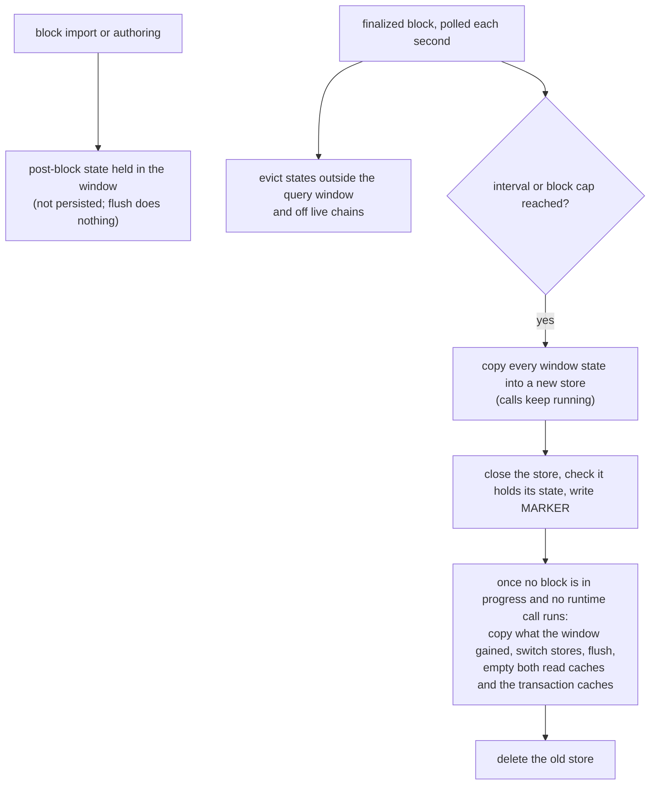

# Snapshot ledger storage

By default the node persists the Midnight ledger state after every block and keeps every version
in `<base>/ledger_storage`. Snapshot mode writes the ledger to disk only at a snapshot, at a recent
finalized block: the store then holds every state the node keeps in memory at that point (that
block's, the query window's and the unfinalized ones), and every newer state stays in memory. No
ledger writes per block and no garbage collector. `StateKey`, the runtime and the host-function ABI are unchanged, and the Midnight
storage crates are used as they are. It is opt-in; with `ledger_storage_mode = "persistent"`
(the default) none of it runs and the on-disk format is unchanged.

## Enabling it

| Setting (env) | Default | |
|---|---|---|
| `ledger_storage_mode` (`LEDGER_STORAGE_MODE`) | `persistent` | `persistent` or `snapshot` |
| `ledger_snapshot_interval_secs` (`LEDGER_SNAPSHOT_INTERVAL_SECS`) | `3600` | snapshot once this much wall-clock time has passed since the last snapshot or the node's start (a restart postpones it)... |
| `ledger_snapshot_block_cap` (`LEDGER_SNAPSHOT_BLOCK_CAP`) | `50000` | ...or this many finalized blocks, whichever first |
| `ledger_query_window` (`LEDGER_QUERY_WINDOW`) | `256` | finalized blocks whose states stay queryable |

Snapshot mode needs `storage_separation = "separate"`, a non-zero `storage_cache_size`, and a
numeric `--state-pruning` of at least `2 * block cap + 4096` (`--blocks-pruning`, if a number,
too): a restart re-executes every block above the snapshot block on its parent's Substrate state.
Subcommands that open the chain database refuse to run in snapshot mode. An existing
persistent-layout `ledger_storage` is converted at the first start. It is opened read-only (an
open still replays a write-ahead log a crash left there) and stays on disk until removed by hand.

Switching back to `persistent` needs a resync: snapshot mode does not update `ledger_storage`, so
a `ledger_storage` left from before the conversion is stale, and nothing warns about it. Remove
it, `ledger_storage_snapshot` and the chain database (`purge-chain`) before restarting in
`persistent` mode.

```text
<base>/ledger_storage_snapshot/MARKER     block, hash and StateKey of the valid snapshot
<base>/ledger_storage_snapshot/snap-*/    the snapshot: a ParityDb in the ledger_storage format
```

## How it works



- **Window.** A post-block state is held by its `StateKey` as a tracked root, so the storage
  engine's reference counts keep every node it reaches; unshared nodes are freed on eviction. The
  window holds nodes, not the ledger data a block loaded from them, as a persisted state would.
- **Reads.** Off-chain runtime calls (RPC, transaction pool) see window states and, until the
  next switch, states any off-chain call produced; anything else fails with `NoLedgerState`.
  Direct reads (warp-sync serving, `midnight_ledgerStats`) see window states only, and fail with
  an error saying the state is outside the window. A call pins every window state it reads until
  it ends, so eviction cannot free nodes it has yet to read; a state an off-chain call produced
  keeps the states it was built from pinned until it is dropped.
- **Eviction.** Each second the node drops window states of blocks older than the query window
  and of forks that left the chain. Unpinned states only, and not the ones of blocks it cannot
  tell, except below the oldest finalized block with Substrate state: a warp-synced node has none
  below its warp target, and no ledger state of those blocks either.
- **Switch.** The storage engine treats a node it has read as stored and never writes it again,
  so every holder of ledger nodes is accounted for before the old store goes: the switch waits
  for the block in progress (authoring holds intermediate states between calls) and then for the
  running calls, copies the window, flushes, and pushes the old store's nodes out of both arenas'
  read caches by reading `storage_cache_size` filler keys into each. It empties the
  verified-transaction caches. The off-chain arena, where cached transactions and states held by
  runtime-API instances live, is never replaced, so they can be dropped at any time.
- **Restart.** The node opens the marked snapshot, checks it against `StateKey` at its block, and
  re-executes every block above it on every live chain before networking starts, checking each
  rebuilt state against the block's `StateKey`.
- **Migration and warp sync.** The ledger 8 -> 9 translation and a warp-synced ledger are held in
  the window, and a snapshot is requested.

## Guarantees and limits

- Every ledger state is computed by the same host functions and ledger code as in the
  persistent layout; only where nodes are kept differs.
- Block import checks blocks as always. A block's `StateKey` is Substrate storage committed by the
  header's state root, so a wrong ledger state shows as a failed import. Comparing `StateKey`s
  with another node shows that blocks imported, nothing more: it is not an independent check of
  the ledger.
- A crash or `kill -9` at any point leaves a valid snapshot: the new store is closed and fsynced
  before `MARKER` is replaced (write, fsync, rename, fsync of the directory); a failed marker
  write removes the new store, a failed switch puts the marker back; startup removes every other
  snapshot directory. Power loss is not tested.
- A restart needs the Substrate state of the snapshot block. Each failed snapshot is logged at
  error level with the blocks left before that state is pruned, and
  `midnight_ledger_snapshot_block` stops advancing. Past that point startup fails and says so;
  recover by removing `<base>/ledger_storage_snapshot` and the chain database (`purge-chain`)
  and syncing again. `purge-chain` alone leaves `ledger_storage_snapshot`, which the next start
  refuses as "not in the chain": remove it too.
- Ledger queries of states outside the window fail with `NoLedgerState`, including historical
  queries the persistent layout answers. Wallets and indexers need a persistent-mode node.
- **Switch pause.** Once the switch asks for its lock, new runtime calls, block import and
  authoring wait: for the calls already running, the copy of what the window gained since the
  snapshot was written, the flush of the nodes created since the last snapshot, and the two
  read-cache refreshes (about 0.3 µs per `storage_cache_size` entry each). Each snapshot logs
  this pause. On preprod at the tip with a cache of 500,000 the log gave 0.3–0.6 s, counted then
  from when the lock was granted, so without the wait for running calls; a long call already
  running (warp-sync serving, `ledger_stats`) adds its duration, once per snapshot.
- **Validators.** A pending switch does not hold up the author's calls while it waits for a
  block to end. Once it asks for its lock, it holds up the author's next call too, until the
  calls already running end.
- **Finality stall.** Unfinalized states stay in memory and snapshots happen only at finalized
  blocks: memory grows for as long as finality stalls.
- **Off-chain sessions.** A runtime-API instance that makes several off-chain calls loses the
  states its earlier calls produced at the next switch (`NoLedgerState`).

## Metrics

`midnight_ledger_window_states`, `midnight_ledger_snapshots_total` and
`midnight_ledger_snapshot_block` (the block a restart replays from). Each snapshot logs its
duration and how long new runtime calls were held, from when the switch asked for its lock.
