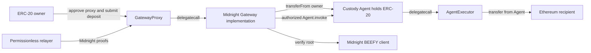

# Ethereum contracts for the Midnight Snowbridge PoC

Research assessment, 22 October 2026. This supplements the
[runtime and ledger proposal](snowbridge-runtime-ledger-integration-spike.md).
Contract code and tests were inspected and compared; no Solidity changes,
compilation, test execution, or deployment were performed for this assessment.

**Reuse Snowbridge's Gateway, proxy, custody Agent, AgentExecutor, token-transfer
libraries, and BEEFY client. Build a narrow Midnight adaptation around them.**
An Ethereum-origin ERC-20 does not need a new vault, wrapped ERC-20, signature
committee, or general-purpose bridge contract on Ethereum. Its representation
is issued on Midnight; Ethereum holds and eventually releases the original.

Prefer the pinned upstream Snowbridge code as the base, selectively porting
DataHaven's standalone MMR verification approach. The inspected upstream has
security-relevant checks absent from the inspected standalone fork. This
refines the earlier recommendation to evaluate the standalone fork: reuse its
proof design without assuming its complete contract tree is the best baseline.

The later [draft v1 specification](snowbridge-implementation-spec.md) chooses
the first candidate: preserve the V2 proof ABI, use only the Fiat–Shamir path
patched to full quorum, and add namespaced domain configuration during atomic
proxy initialization. It also specifies deposit limits and the first gas/proof
gate. These refine the alternatives here and are not compiled changes.

## Exact sources and deployment components

The comparison uses `Snowfork/snowbridge` at
`caeea22dbee4d4da06266b205a61c89484c4e89f` and
`datahaven-xyz/snowbridge` at
`4bebe7032d866ba6b57cda3767afaf586a92680e`. The node and SDK revisions remain
those in the main proposal. These are inspected snapshots, not assertions that
every file at these revisions has audit coverage.

| Component | Reuse decision | Role in our deployment |
| --- | --- | --- |
| [`GatewayProxy.sol`][proxy] | Reuse source unchanged initially | Stable user-facing address, storage, and constructor-time initialization |
| [`Gateway.sol`][gateway] | Reuse with a thin Midnight specialization and limited entry-point patches | Deposit messages, proof verification hook, nonce protection, command execution, and receipts |
| [`Agent.sol`][agent] | Reuse source unchanged | Holds the actual ERC-20 backing; only its creating Gateway can invoke its executor |
| [`AgentExecutor.sol`][executor] | Reuse source unchanged | Executes the ERC-20 release in the custody Agent's context |
| [`BeefyClient.sol`][beefy] | Reuse core implementation; configure Midnight authorities and change quorum policy for the PoC | Verifies signed commitments, tracks authority changes, and stores the latest authenticated MMR root |
| [`v2/Calls.sol`][calls] | Reuse deposit/registration internals | Moves ERC-20 into custody and emits the authenticated asset-transfer message |
| [`v2/Handlers.sol`][handlers] and [`Functions.sol`][functions] | Reuse unlock path and transfer checks | Decode `UnlockNativeToken` and release from the custody Agent |
| [`Initializer.sol`][initializer] | Reuse initial layout and Agent creation initially | Creates custody and governance Agents, initializes registry and legacy settings |
| [`utils/ScaleCodec.sol`][scale], [`utils/MMRProof.sol`][mmr], Merkle/ECDSA utilities | Reuse | Encoding, inclusion proofs, and signatures; no new cryptographic primitives |
| [`Token.sol`][token] / `TokenLib.sol` | Not needed as an asset deployment for the first ERC-20 route | These implement Ethereum representations of foreign assets; relevant to future Midnight-origin tokens |

There are four principal top-level deployments: a BEEFY client, an executor, a
Gateway implementation, and its proxy. The initializer creates two Agent
instances in the inspected layout; one holds token backing. Additional linked
library deployments may be required. Use compiler `linkReferences` and the
deployment manifest to enumerate them rather than treating four as the complete
address count. A local test ERC-20 is a separate deployment.

Reuse **source code in a separate deployment**. Existing Polkadot Gateway and
Agent addresses are bound to their own verifier, storage, and controller; they
are not shared custody for Midnight. An Agent's immutable `GATEWAY` must be our
proxy address. Creating it through the proxy's initializer achieves this.

## Deposit and release using existing entry points

For Ethereum to Midnight:

1. Register the allowlisted ERC-20 using `v2_registerToken(token, network, 0, 0)`.
   Handle the resulting `CreateAsset` event explicitly in the Midnight adapter.
   Registration is not a deposit, and repeated native registration is allowed
   in the inspected implementation.
2. The owner calls `ERC20.approve(gatewayProxy, amount)`. The spender is the
   proxy, not the custody Agent or implementation address.
3. Call `v2_sendMessage(rawMidnightEnvelope, assets, emptyClaimer, 0, 0)` with
   zero ETH value for the sponsored PoC. Supply exactly one asset encoded as
   `abi.encode(uint8(0), token, uint128(amount))`.
4. Snowbridge transfers that ERC-20 into the Agent and emits
   `OutboundMessageAccepted(nonce, payload)` from the proxy address. Midnight
   verifies that event through its Ethereum light client and credits the
   authenticated asset amount.

The `xcm` parameter name in upstream does not force Solidity to execute XCM.
The raw bytes can be our versioned Midnight envelope. The SDK processor must
interpret that envelope and bind it to the destination network and recipient.
Retain the existing event's types and tuple layout so the pinned Rust decoder
can be reused; test exact encodings. [Deposit implementation][calls]

The registration network enum is numerically `0` in both inspected versions:
upstream names it `Polkadot`, while the standalone fork calls it `Solochain`.
For this isolated deployment, either preserve `0` as a documented wire value
or introduce a consistently supported Midnight value. Renaming the enum alone
does not add domain separation. Pin the Ethereum chain, Gateway, and Midnight
genesis in the deployment configuration and application envelope.

For Midnight to Ethereum, the runtime queues one command with kind `2`,
`UnlockNativeToken`, and payload
`abi.encode(token, ethereumRecipient, uint128(amount))`. The relayer updates the
BEEFY client, then calls `v2_submit`. Existing handlers select the custody Agent
and invoke the executor's token transfer. No minting happens on Ethereum for
this route. [Command handling][handlers]

Successful Ethereum transaction inclusion is not sufficient evidence of token
release. Preserve Snowbridge's existing success/failure receipt semantics and
the main proposal's verified retry protocol. One command per redemption avoids
partially successful batches. Do not add a second Ethereum redemption-ID
mapping merely to duplicate the runtime protocol: Snowbridge already prevents
nonce replay, and the runtime must authorize any new nonce only after a proven
failed attempt. [Gateway dispatch][gateway]

## The minimal Midnight proof adaptation

Upstream verifies this chain:

`message → message root → parachain header → parachain-heads root → MMR → BEEFY`.

Midnight should verify:

`message → message root → Midnight MMR leaf extra field → MMR → BEEFY`.

DataHaven's [`BeefyVerification.sol`][solo-verification] implements the latter
MMR step. It hashes the SCALE encoding of the leaf's version, parent number and
hash, next authority-set fields, and a fixed 32-byte application root. Port
that small proof construction, retaining Snowbridge's MMR proof verifier.

**First implementation choice to test: preserve upstream's submit ABI.**
`Gateway._verifyCommitment(commitment, Verification.Proof, isV2)` is already
`internal virtual`. A Midnight specialization can:

- Reject V1 verification.
- Use `proof.leafPartial`, `proof.leafProof`, and `proof.leafProofOrder` to verify
  a leaf whose extra field is the supplied message commitment.
- Require canonical empty values for the unused parachain header/head-proof
  fields, so the accepted envelope has one documented interpretation.
- Call the existing BEEFY client's `verifyMMRLeafProof`.

This preserves upstream's message hashing, nonce protection, dispatch behavior,
and `v2_submit` selector. It still needs a Midnight-aware relayer proof builder;
ABI compatibility does not make an upstream parachain relayer work unchanged.
This specialization is a source-supported proposal, not compiled code.
[Overridable hook][gateway], [upstream proof structure][verification]

The alternative is DataHaven's cleaner `BeefyVerification.Proof` submit ABI,
which removes the unused parachain fields. That requires porting the changed
submit signature and matching relayer bindings. Choose it if the ABI-preserving
approach becomes harder to maintain; do not simultaneously retain two proof
entry points with inconsistent authorization.

The upstream BEEFY client's MMR leaf already ends in a fixed `bytes32`, named
`parachainHeadsRoot`. Its encoder does not require that value to be a parachain
root: for our dedicated deployment it can hold the Midnight outbound root.
Changing the field's name is optional; matching the bytes is mandatory. The
Midnight runtime must still change its current `Vec<u8>` leaf extra field and
authority conversion as described in the main proposal. The full signed BEEFY
payload, including Midnight's custom entries, must be preserved. [BEEFY code][beefy]

## BEEFY policy and bootstrap

Use Midnight's actual current and next BEEFY authority sets and a verified
starting block. Generate the Ethereum-address authority roots with the matching
runtime conversion; do not reuse Snowbridge's Polkadot/Westend checkpoint
constants. The constructor checks consecutive current/next set IDs, but that
does not establish that the roots belong to Midnight.

The client starts with a configured block/set checkpoint, not an already proven
message root. Submit a valid later commitment before exercising message proofs.
Its proof method verifies against `latestMMRRoot`; if another update advances
that root before submission, regenerate the MMR inclusion proof for the latest
root. The historical message and its message-root proof remain associated with
their original block.

For the small development network, keep the proposed full-quorum policy. The
inspected upstream caps signature checks at `floor(N/3)+1`, even when configured
minimums are higher. It also exposes **both** interactive
`submitInitial`/`commitPrevRandao`/`submitFinal` and `submitFiatShamir` paths.
Changing an environment variable cannot force full quorum across these paths.

Make one explicit policy patch: every enabled path must verify at least
`N - floor((N - 1)/3)` distinct authority signatures. Update required-count and
bitfield-generation logic consistently; alternatively disable the unused
submission path. Retain membership, uniqueness, padding, stale-commitment, and
authority-transition checks. Test small and changing set sizes. DataHaven's
quorum cap is a reference, but blindly replacing the entire upstream client
would discard other differences. [Upstream client][beefy], [fork client][solo-beefy]

Full-quorum verification retains the consensus trust assumption and has higher
gas cost; it is not a production economics solution. Retaining the interactive
path also retains its timing protocol. Measure rather than assume latency and
gas costs.

## Keep custody code and restrict the supported surface

The existing initializer creates a custody Agent under `ASSET_HUB_AGENT_ID`.
For the first separate deployment, retain that constant and the existing layout,
documenting it as the local custody ID. Its name does not require an actual
Asset Hub. The same ID occurs in deposits, withdrawals, and arbitrary-call
protection; changing only one reference would be dangerous. Legacy channel
entries can remain inert while their external transfer paths are disabled.

Apply narrow guards around the existing functions rather than rewriting token
custody:

| Surface | Proposed PoC policy |
| --- | --- |
| `v2_registerToken` | Only the fixed test ERC-20 and selected wire network value |
| `v2_sendMessage` | Exactly one allowlisted asset, positive bounded amount, valid version/destination envelope, zero ETH/fees, empty claimer |
| `v2_submit` / dispatch | Exactly one command per message; retain proof and nonce checks |
| `UnlockNativeToken` | Fixed runtime bridge origin; allowlisted ERC-20, nonzero recipient, positive bounded amount |
| `SetOperatingMode` | Optional, only from a separate fixed governance origin with an explicit runtime policy |
| `Upgrade`, `CallContract`, `RegisterForeignToken`, `MintForeignToken` | Disabled for the first PoC |
| V1 `submitV1`, `sendToken`, and unused funding routes | Reject unsupported operations rather than accepting deposits Midnight will not process |

The current `v2_dispatchCommand` is virtual and can enforce command/origin
policy before calling existing `HandlersV2` functions. Several public ingress
functions are not virtual, so a subclass alone cannot enforce all the policy:
small source patches or deliberately added hooks are needed. Keep these changes
in a short, reviewable patch series. A frontend-only allowlist is insufficient;
users can call the public Gateway directly.

The existing Gateway does not independently assign privileged meanings to
every V2 `origin`; upstream relies on authorized message construction on the
source chain. Our runtime must retain that restriction even if Solidity adds
an origin guard. [Gateway dispatch][gateway]

Preserve proxy initialization in its constructor. `GatewayProxy` rejects later
external `initialize` calls, and the initializer rejects direct use on the
implementation. There is no conventional deployer-owned `ProxyAdmin` in this
path; upgrades execute through authenticated bridge commands. With upgrades
disabled and V1 rejected, the PoC has no supported Gateway upgrade route.
Redeployment is the expected response to code changes on a disposable devnet.
Enabling upgrades later requires an explicit governance design and migration
initializer, not rerunning the original initializer. [Proxy][proxy], [upgrade][upgrade]

`SetOperatingMode` currently stops Ethereum-to-Midnight outbound messaging.
It does not automatically freeze Ethereum releases through `v2_submit`. Any
emergency release pause would be an additional deliberate change. Do not
describe the existing mode as a universal emergency stop.

## Important differences found in the fork comparison

These are concrete reasons to favor upstream as the base:

1. Upstream `Functions.transferToAgent` checks the custody balance before and
   after the transfer and rejects a non-exact increase. The inspected standalone
   fork lacks this check. Retain it even with an asset allowlist.
2. Upstream `HandlersV2.callContract` rejects the custody Agent as the arbitrary
   call origin. The inspected fork lacks this guard. Keep the protection even
   if arbitrary calls are disabled for the initial PoC.
3. Gateway dispatch/gas handling and BEEFY submission paths differ materially.
   Porting only the standalone verifier avoids unnecessarily reverting these
   changes. Preserve the consumed-nonce failure receipt behavior and test it.
4. Upstream uses Solidity `0.8.34`; the fork uses `0.8.28`. Their initializer
   config tuples and dependency pins also differ. Source files cannot safely be
   mixed merely because their contract names match.

This was a targeted source comparison, not an exhaustive security audit or
proof that the upstream snapshot has no defects.
[Upstream transfer check][functions], [upstream custody guard][handlers],
[fork transfer helper][solo-functions], [fork handlers][solo-handlers]

## Deployment and test work required

See the [end-to-end testing strategy](snowbridge-e2e-testing-strategy.md) for
local PoS orchestration, actual-verifier acceptance, finalized receipt/retry
checks, gas limits, fault injection and the required evidence bundle.

Create a dedicated Foundry project or pinned Snowbridge contracts checkout,
with the Midnight patch series recorded against the baseline. Preserve license
headers. Reuse upstream test utilities, interfaces, and deployment patterns.
Do not use the supplied `deploy.sh` unchanged: the inspected script targets
chain ID 1 and broadcasts. The checkpoint deployment script also contains
network-specific constants. Create an explicit local/testnet configuration.
[Deployment script][deploy], [checkpoint script][deploy-beefy]

For reproducibility, upstream pins these dependencies as git submodules:

| Dependency | Commit at inspected upstream revision |
| --- | --- |
| OpenZeppelin contracts | `fcbae5394ae8ad52d8e580a3477db99814b9d565` |
| forge-std | `7117c90c8cf6c68e5acce4f09a6b24715cea4de6` |
| PRB Math | `77fa88eda4a4a91b3f3e9431df291292c26b6c71` |
| canonical-weth | `ea174e6f07efe8be85690cf38192155033c425e2` |

Keep the pinned compiler and production optimization profile; explicitly select
an EVM target supported by the chosen chain. The reentrancy guard uses
`TLOAD`/`TSTORE`, so the EVM must support transient storage. Verify deployed code
size and actual gas under realistic limits; the upstream test configuration has
a very high gas limit. A local execution-only chain can test Solidity behavior,
but the complete inbound proof flow needs the supported Ethereum PoS stack.
[Foundry configuration][foundry]

The deployment sequence is:

1. Record Ethereum chain ID, Midnight genesis, finalized bootstrap block, current
   and next authority sets, leaf version, and selected quorum policy.
2. Build/link the selected libraries and contracts; record code hashes and
   compiler settings. Deploy the configured BEEFY client and AgentExecutor.
3. Deploy the Midnight Gateway implementation referencing those addresses;
   deploy `GatewayProxy` with the matching initializer tuple atomically.
4. Verify implementation address, BEEFY/executor immutables, Agent mapping and
   Agent controller. Configure Midnight's verifier with the proxy address.
5. Register the test ERC-20, relay the registration event, and confirm the
   pinned asset/color mapping. Submit the first real BEEFY update.
6. Execute deposit, wallet transfer, escrow, and release. Persist addresses,
   artifact hashes, receipts, proof inputs, and reproducible test commands.

Use Snowbridge's canonical WETH test fixture or a simple conventional test ERC-20.
`Token.sol` can be a separate test token under a test issuer, but a real
Ethereum-origin asset needs no Snowbridge token deployment. For a future
Midnight-origin asset, reuse `RegisterForeignToken`, `MintForeignToken`, and
`Token.sol` after defining the inverse ledger burn/lock accounting.

Start with existing `GatewayV2.t.sol`, `Agent.t.sol`, `MMRProof.t.sol`,
`ScaleCodec.t.sol`, `BeefyClient.t.sol`, and `BeefyClientAdvanced.t.sol`. Preserve
the deposit exactness, custody arbitrary-call, nonce replay, partial execution,
insufficient gas, and authority-transition cases. Upstream Gateway tests use
`MockGateway` with switchable proof verification; those tests validate dispatch
behavior, not Midnight consensus interoperability. Add a real verifier suite.
[Gateway tests][gateway-tests], [mock verifier][mock], [BEEFY tests][beefy-tests]

Additional acceptance cases must prove: direct Agent calls fail; no alternate
submission path accepts too few signatures; unused V1 and command paths cannot
move funds; bad destination envelopes fail before custody changes; an invalid
proof rolls back nonce consumption; a valid failed unlock consumes the nonce
and emits `success=false`; the same nonce cannot release twice; and a new nonce
is only issued by the runtime after the corresponding finalized failure.

The next deliverable is an ABI/MMR compatibility fixture and a compiled minimal
Midnight Gateway specialization. Full PoC integration follows those tests. The
local research checkouts have not had their Solidity submodules initialized, so
the current source inspection is not a successful build result.

[proxy]: https://github.com/Snowfork/snowbridge/blob/caeea22dbee4d4da06266b205a61c89484c4e89f/contracts/src/GatewayProxy.sol
[gateway]: https://github.com/Snowfork/snowbridge/blob/caeea22dbee4d4da06266b205a61c89484c4e89f/contracts/src/Gateway.sol
[agent]: https://github.com/Snowfork/snowbridge/blob/caeea22dbee4d4da06266b205a61c89484c4e89f/contracts/src/Agent.sol
[executor]: https://github.com/Snowfork/snowbridge/blob/caeea22dbee4d4da06266b205a61c89484c4e89f/contracts/src/AgentExecutor.sol
[beefy]: https://github.com/Snowfork/snowbridge/blob/caeea22dbee4d4da06266b205a61c89484c4e89f/contracts/src/BeefyClient.sol
[calls]: https://github.com/Snowfork/snowbridge/blob/caeea22dbee4d4da06266b205a61c89484c4e89f/contracts/src/v2/Calls.sol
[handlers]: https://github.com/Snowfork/snowbridge/blob/caeea22dbee4d4da06266b205a61c89484c4e89f/contracts/src/v2/Handlers.sol
[functions]: https://github.com/Snowfork/snowbridge/blob/caeea22dbee4d4da06266b205a61c89484c4e89f/contracts/src/Functions.sol
[initializer]: https://github.com/Snowfork/snowbridge/blob/caeea22dbee4d4da06266b205a61c89484c4e89f/contracts/src/Initializer.sol
[scale]: https://github.com/Snowfork/snowbridge/blob/caeea22dbee4d4da06266b205a61c89484c4e89f/contracts/src/utils/ScaleCodec.sol
[mmr]: https://github.com/Snowfork/snowbridge/blob/caeea22dbee4d4da06266b205a61c89484c4e89f/contracts/src/utils/MMRProof.sol
[token]: https://github.com/Snowfork/snowbridge/blob/caeea22dbee4d4da06266b205a61c89484c4e89f/contracts/src/Token.sol
[verification]: https://github.com/Snowfork/snowbridge/blob/caeea22dbee4d4da06266b205a61c89484c4e89f/contracts/src/Verification.sol
[solo-verification]: https://github.com/datahaven-xyz/snowbridge/blob/4bebe7032d866ba6b57cda3767afaf586a92680e/contracts/src/BeefyVerification.sol
[solo-beefy]: https://github.com/datahaven-xyz/snowbridge/blob/4bebe7032d866ba6b57cda3767afaf586a92680e/contracts/src/BeefyClient.sol
[upgrade]: https://github.com/Snowfork/snowbridge/blob/caeea22dbee4d4da06266b205a61c89484c4e89f/contracts/src/Upgrade.sol
[solo-functions]: https://github.com/datahaven-xyz/snowbridge/blob/4bebe7032d866ba6b57cda3767afaf586a92680e/contracts/src/Functions.sol
[solo-handlers]: https://github.com/datahaven-xyz/snowbridge/blob/4bebe7032d866ba6b57cda3767afaf586a92680e/contracts/src/v2/Handlers.sol
[deploy]: https://github.com/Snowfork/snowbridge/blob/caeea22dbee4d4da06266b205a61c89484c4e89f/contracts/scripts/deploy.sh
[deploy-beefy]: https://github.com/Snowfork/snowbridge/blob/caeea22dbee4d4da06266b205a61c89484c4e89f/contracts/scripts/DeployBeefyClient.sol
[foundry]: https://github.com/Snowfork/snowbridge/blob/caeea22dbee4d4da06266b205a61c89484c4e89f/contracts/foundry.toml
[gateway-tests]: https://github.com/Snowfork/snowbridge/blob/caeea22dbee4d4da06266b205a61c89484c4e89f/contracts/test/GatewayV2.t.sol
[mock]: https://github.com/Snowfork/snowbridge/blob/caeea22dbee4d4da06266b205a61c89484c4e89f/contracts/test/mocks/MockGateway.sol
[beefy-tests]: https://github.com/Snowfork/snowbridge/blob/caeea22dbee4d4da06266b205a61c89484c4e89f/contracts/test/BeefyClient.t.sol
