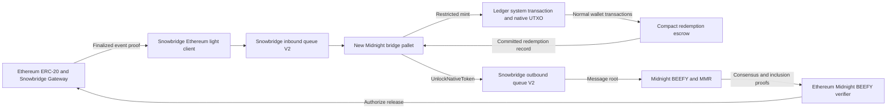

# Snowbridge runtime and ledger integration spike

Research spike, 22 October 2026. Source-level design; no bridge has been built or
deployed as part of this spike.

**Historical design:** the [continuation checklist](#continuing-from-this-spike)
records the research-stage recommendations. For the implemented PoC, start with
the [current runbook](../../tests/snowbridge/README.md) and
[recorded validation](../../tests/snowbridge/evidence/README.md).

The follow-up [Ethereum contracts spike](snowbridge-ethereum-contracts-spike.md)
details the reusable custody stack and deployment plan. It refines the Solidity
baseline toward upstream with a narrow standalone proof adaptation and identifies
the need to enforce full quorum across every enabled BEEFY submission path.

The [Compact usability spike](snowbridge-compact-token-usability-spike.md)
finds that existing receive, balance, and send operations can support a native
bridge asset. It adds an ordinary consumer-contract fixture and identifies
transaction funding, client replay, and compiler alignment as validation gates.

The [end-to-end testing strategy](snowbridge-e2e-testing-strategy.md) turns these
requirements into a local real-consensus stack, independent observer, accounting
and per-transfer invariants, failure matrix, replay checks and CI acceptance gates.
It distinguishes proposed tests from evidence actually obtained.

The [draft v1 implementation specification](snowbridge-implementation-spec.md)
selects initial implementation choices and gives the exact domain/envelope/ID
definitions, retry state machine, sealed escrow/accessor boundary, repository
work map and compatibility gate. Use those details over the earlier alternatives
below where they differ; they still require executable validation.

**Use Snowbridge for verification and message transport in both directions, with
a new Midnight bridge pallet and a narrow ledger system transaction for minting
the native unshielded representation of an Ethereum ERC-20.** Redemption can use
existing Compact escrow and normal ledger transactions, followed by a runtime
read of the committed redemption record. This avoids implementing privileged
burning in the first PoC.

This is a separate Snowbridge deployment for Midnight. The deployed
Ethereum–Polkadot bridge cannot authenticate Midnight automatically. Reuse the
Snowbridge pallets already present in the pinned SDK, and adapt the Solidity
proof path and relayer for a standalone chain. DataHaven's Snowbridge fork provides
a concrete reference for this adaptation. No Asset Hub, XCM routing, or
`pallet-assets` representation is required for the proposed ledger token path.
[Integration model][integration], [standalone implementation][solo-readme]

The smallest credible demonstration is: **lock ERC-20 → mint native Midnight
token → transfer between two Midnight wallets → escrow on Midnight → release
ERC-20 to an Ethereum recipient**, with relayers supplying proofs rather than
authorizing transfers through their own signatures.

## Scope and source baseline

Use one allowlisted conventional ERC-20, public amounts and recipients, a fresh
Midnight development network, and local Ethereum proof of stake at a supported
fork. Exclude rebasing and fee-on-transfer tokens. Keep integer base units equal
across chains, provision Midnight DUST separately, and sponsor relay costs.
Choose bounded test amounts; the runtime issuance path can use `u128`, whereas
the alternative Compact mint function accepts `Uint<64>`.

| Component | Inspected revision |
| --- | --- |
| Midnight node | `ad8f2802c16594fb3c0a54c5976cab98bdeaab20` |
| Pinned Polkadot SDK | `shieldedtech/polkadot-sdk@9c7455eabd0cc2e77da867e837dfb466b11fbcf6` |
| Pinned ledger | `midnightntwrk/midnight-ledger@48a978d7fc4342e8f5536eb95f47139477e1a0e8` |
| Upstream Snowbridge | `Snowfork/snowbridge@caeea22dbee4d4da06266b205a61c89484c4e89f` |
| Standalone reference | `datahaven-xyz/snowbridge@4bebe7032d866ba6b57cda3767afaf586a92680e` |
| Compact standard library 0.34.0 | `LFDT-Minokawa/compact@1f671fc27818df2b2676b3a97f85b2b821756243` |

These revisions are inputs to compatibility tests, not a claim that upstream
and fork contracts are interchangeable. Compare the standalone changes with
upstream security fixes before selecting the implementation baseline.

## Proposed architecture

| Runtime component | Responsibility and integration |
| --- | --- |
| `snowbridge-pallet-ethereum-client` | Verify beacon consensus updates and finalized Ethereum event proofs; configure network fork schedule and bootstrap checkpoint |
| `snowbridge-pallet-inbound-queue-v2` | Verify Gateway address and replay nonce; set `MessageProcessor` to the new Midnight adapter |
| New bridge pallet | Asset registry, pending deposits, authorized issuance, redemption records, outbound attempts, and verified success/failure receipts |
| `pallet-message-queue` | Schedule bounded outbound message processing |
| `snowbridge-pallet-outbound-queue-v2` | Encode commands, assign nonces, commit messages, expose message proofs, and process relay rewards |
| Existing BEEFY/MMR pallets | Commit outbound roots in an Ethereum-compatible MMR leaf and authenticate them with Midnight authority signatures |
| Existing Midnight and MidnightSystem pallets | Own the canonical ledger root and emit replayable system transactions; add a restricted Ethereum issuance executor |

The inbound queue already exposes the needed `MessageProcessor` hook. Its V2
message carries authenticated asset transfers separately from a raw payload.
Use that payload for a versioned Midnight destination envelope; it need not be
interpreted as XCM. The SDK ABI tuple uses an `xcm` field name in places where
the standalone contracts use `message`; compare encoded fixtures rather than
assuming field names determine compatibility. [Inbound queue][inbound],
[message types and processor][inbound-types]

Configure rewards and fees explicitly. For the first deployment, use zero
protocol relay rewards and a suitable no-op reward adapter where the traits
allow it, with operator-funded gas. This still requires valid queue weights,
gas limits, and transaction submission on Midnight; it does not require creating
an Ethereum fee currency inside the privacy ledger.

## Existing ledger functions we can reuse

| Existing function or type | Useful capability | Constraint |
| --- | --- | --- |
| `LedgerStateProviderMut::mut_ledger_state` | Load the canonical root and replace it only when the closure succeeds | Use inside the bridge transaction boundary; it is not a complete cross-database rollback mechanism |
| MidnightSystem `apply_and_emit` | Apply a restricted system transaction and emit its serialized form | Extend through a dedicated Ethereum capability; the helper is not a public generic mint extrinsic |
| `LedgerApi::apply_transaction` | Execute an ordinary, proven ledger transaction | Reuse for wallet transfers and redemption escrow; it does not bypass proof or balance checks |
| `LedgerApi::get_contract_state` | Read the committed contract state at a ledger root | Decode the fixed escrow schema, bound the cost, and reject unknown contract/version; consider a narrow host accessor |
| `Ledger::apply_system_tx` | Apply a system transition with ledger cost/fullness handling and persistence | Add a supported serialized variant and its semantics |
| `UtxoState::insert` | Insert a native unshielded UTXO with metadata | Low-level map operation; supplies no bridge authorization, replay protection, or issuance accounting |
| `LedgerState::index` / `update_index` | Read/write contract state and balance | Low-level mutation; not a Compact call, and `update_index` can default a missing contract |
| Compact `receiveUnshielded` | Fund an escrow contract from an ordinary transaction | Locks tokens in contract balance; it is not a burn |
| Compact `mintUnshieldedToken` | Issue a contract's token in a proven contract transaction | Cannot be invoked directly as a Rust runtime mint function |

Local integration points are
[the root provider](../../pallets/midnight/src/lib.rs),
[system execution and events](../../pallets/midnight-system/src/lib.rs),
[runtime-facing ledger functions](../../ledger/src/ledger_9/mod.rs),
[ledger execution and accounting](../../ledger/src/ledger_9/api/ledger.rs), and
[host interfaces](../../ledger/src/host_api/ledger_9.rs).
Underlying ledger types are in [structure.rs][ledger-structure]; Compact
operations are in the [standard library][compact].

### Why existing treasury and Cardano functions are insufficient

`PayFromTreasuryShielded` and `PayFromTreasuryUnshielded` are present in the
system transaction enum, but both return `TreasuryDisabled` in the pinned
ledger. Even enabled treasury payments would spend treasury backing rather than
provide unrestricted issuance. `native_issue_unbalanced` is private and retained
for disabled treasury interactions; it is not an exported runtime API.
[Ledger semantics][ledger-semantics]

`apply_bridge_system_transaction` currently accepts the Cardano/NIGHT family
of operations, including `DistributeNight(CardanoBridge)`, `DistributeReserve`,
and `UnlockToTreasury`. Reusing that authority to issue arbitrary ERC-20 colors
would expand an unrelated privilege. Add a separate executor and allowlist.

### Recommended issuance extension

Introduce a serialized system transaction, provisionally named
`CreditEthereumAsset` **(new API, not an existing function)**, containing the
registered color, amount, recipient, and unique deposit identity. Its semantics
can reuse `UtxoState::insert`, `Utxo`, and `UtxoMeta`, plus existing ledger
serialization, cost accounting, persistence, and event replay.

The new restricted host entry point must accept only this transaction family.
The runtime constructs it from a verified pending deposit, never arbitrary user
mint parameters. Keep it unavailable through existing general-purpose system
transaction dispatchers unless an explicitly intended governance policy says
otherwise. Add the host function with the repository's interface versioning
mechanism; do not gate behavior on a guessed runtime `spec_version`.

Use a deterministic output identity bound to the Midnight genesis, Ethereum
chain, Gateway, inbound nonce, ERC-20, recipient, and amount. Reject a duplicate
UTXO key; `insert` alone can overwrite. Retain a consumed-deposit marker after
the output is spent. Pin the color in the asset registry, prohibit NIGHT, and
ensure no ordinary contract or maintenance path can independently mint the same
color. One candidate is the color derived from the fixed redemption contract
and domain, with no mint operation and no upgrade authority; validate that
deployment policy in the ledger fixture before committing to it.

**Serialize the transition rather than silently inserting a UTXO in a host
function.** The existing toolkit reconstructs state from ordinary transaction
extrinsics and `MidnightSystem::SystemTransactionApplied` event bytes. A new
pallet event containing an arbitrary UTXO delta is not enough for this replay
path. Updated ledger libraries must understand the new variant; rebuild and
verify the toolkit, indexer, and wallet consumers against it.
[Replay implementation](../../util/toolkit/src/fetcher/compute_task.rs),
[system transaction replay](../../ledger/helpers/unsafe/src/ledger_9/context.rs)

This is a small ledger extension in scope, but it changes a serialized protocol
surface. It needs a ledger release/version decision and corresponding client
dependencies. New pallets alone do not deliver native wallet compatibility.

## Ethereum to Midnight flow

1. The user locks the allowlisted ERC-20 through the selected Snowbridge Gateway
   V2 asset path and supplies the Midnight recipient envelope.
2. Relayers update the Ethereum light client and submit the finalized event
   proof to the inbound queue. Verification binds the event to Ethereum
   consensus, the configured Gateway, and an unused nonce.
3. The Midnight `MessageProcessor` validates the version, destination domain,
   recipient, asset registry, and bounded amount. Require exactly one supported
   `NativeTokenERC20` entry and reject unsupported assets and native ETH. Derive
   the credit from the authenticated asset transfer, not an untrusted amount in
   the raw payload. Implement an explicit allowlisted registration path for
   `CreateAsset` messages or bootstrap registration separately.
4. The processor durably records `PendingDeposit` and returns success. This
   consumes the inbound nonce once, independently of available ledger capacity.
5. A permissionless `materialize_deposit(id)` applies `CreditEthereumAsset`
   through the restricted system executor, updates the canonical root, emits
   the normal system-transaction event, and marks the deposit credited in one
   FRAME transaction. A ledger block-full error leaves it pending for retry.
6. Updated ledger clients discover the output, and the recipient spends it
   through normal Midnight transactions.

The pinned FRAME macro wraps dispatchables in a storage layer. Thus the inbound
queue setting its nonce before calling the processor is not, by itself, a
nonce-loss bug when the dispatch returns an error. Hooks and message-queue
processing need their own explicit atomicity analysis. Host ledger persistence
also needs testing in both `DbSeparate` and `DbUnified`: FRAME rollback of the
canonical root does not imply rollback of every external database write.
[FRAME dispatch wrapping][frame-call]

Preserve ledger block-fullness accounting and post-block validation when adding
the system variant. Creating a fresh ledger wrapper that resets consumed cost
would bypass block limits. Bound both FRAME weight and ledger cost, including
proof sizes and contract-state reads.

## Midnight to Ethereum flow

1. A fixed Compact escrow circuit calls `receiveUnshielded(color, amount)` and
   records an immutable redemption ID, amount, and Ethereum recipient. Require
   payment and record creation in the same successful transaction segment.
   Provide no spend, refund, mint, or upgrade path for the retired color.
2. Anyone calls `export_redemption(id)`. The bridge reads the actual committed
   escrow state through `get_contract_state` or a new bounded schema-specific
   accessor. It validates the contract, asset, record, and unexported ID. A
   signed FRAME caller or a caller-supplied amount is not evidence of ownership
   or payment.
3. In one transactional operation, mark the record queued and send exactly one
   `Command::UnlockNativeToken { token, recipient, amount }` through outbound
   V2 `SendMessage::validate` / `deliver`. Construct commands internally under
   a fixed bridge origin; do not expose arbitrary Gateway commands.
4. The message queue processes the ticket and assigns its Snowbridge nonce.
   Record the mapping from nonce to redemption attempt. A small
   `ProcessMessage` wrapper can delegate to the existing outbound processor,
   then bind its newly assigned nonce to the decoded ID on success; account for
   its extra weight and wrap mutations transactionally. Alternatively add a
   narrow accepted-message callback. `MessageAccepted { id, nonce }` is useful
   to relayers but should not be the runtime's only durable attempt record.
5. Outbound finalization commits the message root. A subsequent MMR leaf commits
   that root; a finalized BEEFY commitment authenticates the MMR. Relayers submit
   the signature, MMR, and message inclusion proofs to the Ethereum deployment.
6. The Gateway attempts the ERC-20 release. Relay its finalized result back to
   the Midnight bridge so the redemption becomes completed or retryable.

The representation remains permanently escrowed, so this is lock/mint followed
by retire/release, not a true burn. A later burn can debit already escrowed
balance through a new ledger transition. Do not use low-level `UtxoState::remove`
to confiscate arbitrary user outputs.

Normal Midnight transactions can partially succeed. Only export a record found
in committed ledger state with its required payment in the same successful
segment; an extrinsic's `Ok` status alone does not prove the intended escrow
executed. Re-export protection belongs in runtime storage, independent of
whether the contract record remains visible forever.

### Delivery failures require an explicit retry protocol

In the standalone Gateway, `v2_submit` sets the inbound nonce and then dispatches
commands. Handler failures can be caught, producing
`InboundMessageDispatched(nonce, topic, success=false, ...)` while the outer
Ethereum transaction succeeds. **That nonce is consumed even though release
failed.** A complete outer revert, such as an invalid proof, instead rolls back
the nonce. [Gateway implementation][gateway]

The pinned outbound pallet's `process_delivery_receipt` removes the pending
reward order and emits `MessageDelivered` without testing `receipt.success`.
Treat this as transport/reward bookkeeping, not proof that funds were released.
[Outbound queue implementation][outbound]

Add `submit_redemption_receipt` to the bridge pallet, reusing the Ethereum
verifier. Check the Gateway, event type, nonce-to-attempt mapping, topic, and
success flag. Keep attempt records independently of Snowbridge `PendingOrders`,
which its reward receipt handler may delete.

| Proven result | Action |
| --- | --- |
| Outer transaction reverted or has no finalized receipt | Same attempt remains pending; retry the same proven message when appropriate |
| Finalized `success=true` | Mark redemption completed permanently |
| Finalized `success=false` for the one-command attempt | Consume the failure receipt once; permit one replacement attempt with a new Snowbridge nonce |
| No receipt after a timeout | Keep pending; timeout alone cannot authorize another payout attempt or a refund |

Use one unlock command per message so `success=false` cannot conceal an earlier
successful command in the same batch. Keep a stable redemption ID as the topic,
but bind each retry to its own recorded nonce and allow only one active attempt.
For the allowlisted conventional ERC-20, a failed handler reverts its transfer.
Do not generalize this argument to arbitrary command batches or token behavior.

## BEEFY and MMR changes required for a standalone chain

Midnight already runs ECDSA BEEFY and a Keccak MMR, but its current encoding is
not the standalone Snowbridge proof format. Inspect
[runtime configuration](../../runtime/src/lib.rs),
[authority helpers](../../runtime/src/beefy.rs), and
[signed payload construction](../../node/src/payload.rs).

| Current behavior | PoC change |
| --- | --- |
| `RawBeefyId` supplies compressed public-key bytes for authority leaves | Use the SDK Ethereum-address conversion, such as `BeefyEcdsaToEthereum`, and verify identical Solidity roots |
| `LeafExtra = Vec<u8>` and provider `()` | Use fixed `H256` outbound root and a provider fed by `OnNewCommitment` |
| Custom signed payload includes `mh`, `cs`, `cb`, and potentially `ns`, `nb` | Relay and verify the complete signed SCALE payload, not a reconstructed `mh`-only payload |
| Parachain proof path in upstream Snowbridge | Use the standalone MMR leaf's application root directly |
| `EquivocationReportSystem = ()` | Do not import Polkadot's slashing/economic assumptions into the PoC |

The standalone Solidity leaf layout has a fixed 32-byte application root.
`Vec<u8>` adds a SCALE length prefix even if it contains 32 bytes; it is not
equivalent to `H256`. Version the changed leaf format. Use a fresh development
chain first, and separately evaluate compatibility with existing Cardano bridge
consumers before proposing any deployed-network migration.
[Standalone MMR verifier][mmr-verifier]

Outbound roots are produced in finalization while the MMR leaf is normally
created during initialization. Persist the latest root and prove the correct
following leaf. Test message block, parent block, leaf index, and genesis/MMR
activation offsets explicitly, including empty blocks. The relayer's existing
block-minus-one assumptions are not a substitute for this fixture.

The actual runtime authority handler is `BeefyMmrLeaf`; auxiliary custom roots
can include stake bytes and must not be substituted for its authority roots.
Bootstrap the Ethereum verifier from the intended current/next sets and a
trusted checkpoint; test validator-set rotation, not just a single static set.

For the small PoC set, verify a full BEEFY quorum instead of relying on sampled
signature economics. The inspected standalone fork caps its signature count at
`computeQuorum(N)`; configure its minimum to reach that cap for every supported
set size and verify this with contract tests. This setting is implementation
specific: upstream's sampling cap differs. Neither configuration adds slashing
to Midnight. [Standalone BEEFY client][beefy], [upstream client][upstream-beefy]

## Relayers and network compatibility

Reuse Snowbridge's beacon update, Ethereum event relay, BEEFY relay, outbound
message relay, and delivery receipt responsibilities. The standalone fork is a
starting point, but adapt metadata, pallet names, signed transaction extensions,
fees, and root/leaf mapping for Midnight. Relayers must not have mint authority.

Expose the outbound `prove_message` runtime API and serve it at the historical
message block. Its proof is reconstructed from that block's `Messages`; transient
`MessageLeaves` are removed when the root is committed. Retain the necessary
archive state and enable MMR offchain indexing on proof-serving nodes. A current
root alone cannot reconstruct old message proofs. [Proof API][proof-api]

Public Ethereum testnet compatibility is an initial gate. The pinned beacon
types list forks through Fulu and have no Gloas entry. Ethereum's October 16
announcement says Glamsterdam activated on Sepolia on October 6 and is scheduled
for Hoodi on October 26. Use a local supported PoS network initially, then prove
the selected light client and relayer accept real post-fork fixtures before
promising a public-testnet round trip. Merely adding a fork version constant is
not evidence that changed consensus proof structures are supported.
[Pinned beacon types][beacon-types], [Ethereum announcement][ethereum-forks]

## Alternatives and implementation sequence

| Alternative | Assessment |
| --- | --- |
| Direct low-level UTXO insertion through a new host function | Technically possible, but still needs authorization, cost accounting, and custom client replay; serialized system issuance is preferable |
| Runtime-fed contract mailbox plus normal Compact mint | Reuses `update_index` and `mintUnshieldedToken`, but needs authenticated mailbox consumption, proof binding, fixed schema, and replayable runtime state edits; it does not remove the adapter work |
| Submit a normal proven mint transaction from a relayer | Works only if the contract verifies the finalized bridge authorization; trusting the relayer's signature would change the requested security model |
| Use `pallet-assets` | Useful optional transport smoke test; does not satisfy native Midnight ledger transfers |

Implement in this order, stopping at a failing compatibility gate before building
dependent integration:

1. **Proof fixtures:** exact Gateway/inbound ABI, full BEEFY payload, authority
   roots, fixed MMR leaf, message root, validator rotation, Ethereum fork support.
   Select and pin the upstream/standalone combination after these pass.
2. **Ledger fixture:** new system variant creates one native output; normal
   wallet transfer and Compact escrow work; replay from serialized events yields
   the identical state root. Confirm color ownership and schema/upgrade policy.
3. **Runtime plumbing:** light client, queues, bridge registry, pending credit,
   restricted executor, queue-attempt binding, root provider, proof API, and
   verified redemption receipt handler. Regenerate runtime metadata and required
   ledger/genesis artifacts for the new development network.
4. **Full round trip:** relay both chains, transfer between wallets, redeem to
   another Ethereum account, restart relayers mid-flight, and show balances and
   canonical state remain consistent.

The material work is not just adding pallets: it includes Solidity proof-format
integration, ledger serialization/client support, and the relayer. A planning
allowance is several engineer-weeks after compatibility fixtures pass; Ethereum
fork support or ledger release coordination can dominate that estimate.

## Acceptance tests

Use the [end-to-end strategy](snowbridge-e2e-testing-strategy.md) for the detailed
environment, observability, causal accounting snapshots, fault injection and
evidence requirements. The matrix below is the architecture-level checklist.

| Area | Required evidence |
| --- | --- |
| Authorization | Invalid beacon/MMR/message/authority proofs, wrong Gateway/domain/asset/recipient encoding, and unfinalized Ethereum events cannot mint or release |
| Inbound replay | Duplicate submission, duplicate materialization, and replay after spending the original UTXO never create another credit |
| Native usability | Newly issued token appears in an updated wallet, transfers normally, is received/queried/sent by an ordinary Compact consumer, and funds the exact redemption escrow circuit |
| Atomicity | Ledger block-full and injected errors preserve retryability; FRAME root and replayed ledger agree in both storage modes and after reorg/restart |
| Retirement | No export without committed funded record; partial transaction failure cannot fabricate it; no refund or upgrade can reactivate retired backing |
| Queue lifecycle | Enqueued, accepted, committed, and Ethereum-dispatched states remain distinct; capacity limits and delayed processing do not duplicate requests |
| Failure receipts | Forced ERC-20 release failure consumes the nonce; finalized false receipt permits one new attempt; stale/duplicate receipts and timeouts cannot authorize double payout |
| Proof serving | Historical message proof and following MMR leaf verify across empty blocks, restart, and authority-set changes |
| Accounting | Ethereum locked backing covers circulating Midnight representation plus pending mint and unsettled redemption liabilities, measured at reconciled finalized checkpoints |
| Replay compatibility | Node, toolkit, indexer, and wallet libraries interpret the new system transition consistently and reproduce the same ledger state |

The recommendation is ready for a proof-fixture implementation spike. Runtime
compilation, contract tests, ledger replay tests, and a live transfer remain
implementation acceptance criteria, not completed results of this research.

## Continuing from this spike

### Request and document precedence

The user requested research into **Snowbridge for Ethereum ↔ Midnight token
transfers**, explicitly allowing new pallets and asking to reuse existing ledger
functions where possible. Research is complete at the source-analysis level.
Implementing the PoC is the next phase if requested; this handoff does not imply
that implementation, deployment, or publishing has already been authorized.

Read the documents in this order:

1. **This document** is the current recommendation and detailed ledger
   integration analysis. Its serialized issuance proposal and verified
   redemption-failure handling take precedence over earlier suggestions.
2. [Draft v1 implementation specification](snowbridge-implementation-spec.md)
   refines the alternatives into an initial protocol, repository change map,
   sealed escrow/accessor design and actual-verifier compatibility gate.
3. [Compact usability spike](snowbridge-compact-token-usability-spike.md)
   explains how ordinary applications receive, inspect, and spend the asset,
   and the funded transaction fixture needed to establish that integration.
4. [Ethereum contracts spike](snowbridge-ethereum-contracts-spike.md) refines
   the Solidity baseline, proof adapter, custody reuse, deployment plan, and
   quorum policy based on a comparison of upstream and standalone contracts.
5. [End-to-end testing strategy](snowbridge-e2e-testing-strategy.md) defines
   the local stack, independent oracles, proof and failure tests, and implementation
   gates. None of its proposed bridge scenarios has been executed by this spike.
6. [Snowbridge token transfer PoC](snowbridge-token-transfer-poc.md) provides
   additional transport, standalone-chain, and relayer background. Its FRAME
   asset demonstration is an optional diagnostic milestone, not completion of
   the requested native ledger transfer.

The earlier attestation-first recommendation is superseded. Do not restart
with a trusted mint signer.

User requirements are distinct from our proposed implementation choices. The
serialized `CreditEthereumAsset` variant, permanent redemption escrow, one-token
scope, and full-quorum development verifier are recommendations to validate;
their feasibility has not been established by executable tests. The API names
`materialize_deposit`, `export_redemption`, and `submit_redemption_receipt` are
also proposed, not existing code.

### Historical workspace and completed work

At the 22 October research handoff, the checkout used the node revision in the
baseline table and the reports were local drafts. This section describes that
research stage; the implementation, patches, runbooks and public validation
snapshot are now included in this branch.

Completed: source inspection of the pinned node, SDK, ledger, Compact library,
upstream Snowbridge, and standalone fork; architecture and failure-state design;
and local documentation link/reference and whitespace checks. No bridge code,
proof fixtures, dependency integration, runtime build, contract test, wallet
replay test, deployed address, or running relay service was produced. Treat all
test matrices above as outstanding work.

The report's repository URLs and commit IDs are the portable source record.
These local locations can save time on this machine, but are disposable caches:

| Source | Local location used during research |
| --- | --- |
| SDK | `~/.cargo/git/checkouts/polkadot-sdk-b0432a56566bee6a/9c7455e` |
| Ledger | `~/.cargo/git/checkouts/midnight-ledger-b2f9c59d942dfdca/48a978d` |
| Upstream Snowbridge | `/private/tmp/midnight-snowbridge-research` |
| Standalone Snowbridge | `/private/tmp/midnight-snowbridge-solochain-research` |

If these paths are missing, clone the repositories linked in this document and
check out the exact baseline commits. Use separate editable checkouts for
implementation; do not modify Cargo's dependency cache. Inspect `Cargo.lock`
again if the node revision changes: ledger-related packages can come from
different commits, so the main ledger revision is not a substitute for checking
each package's pin.

`COMPACTC_VERSION` is `0.34.0` at this baseline. The local `compact/` submodule
was at `73ebfbbff78118e77a83fdc99dca352db0020869`, while the researched 0.34.0
library is pinned in the table above. Verify the compiler actually selected by
the build; do not assume the submodule or an existing `COMPACT_HOME` matches it.
External Solidity dependencies and a working local Ethereum stack have not been
prepared by this spike. Follow repository setup instructions before executing
tests, and recheck current Ethereum fork compatibility before selecting a
public network.

### First concrete implementation deliverable

After implementation is requested, start with a **reproducible compatibility
fixture suite**, before wiring a complete runtime. Read `AGENTS.md` and any local
rules, inspect the worktree, preserve the reports, and use a new implementation
branch. Record actual tool versions, dependency pins, setup commands, test
commands, and results alongside the fixtures.

The first suite should contain:

1. One Ethereum V2 asset-transfer event encoded with the selected Gateway ABI
   and decoded by the pinned SDK, including the raw Midnight recipient envelope.
2. One outbound `UnlockNativeToken` message with matching Rust/Solidity ABI
   bytes, leaf hash, and Merkle root.
3. One complete Midnight BEEFY payload and authority set that the selected
   Ethereum verifier accepts, with the fixed-width MMR application root and
   correct message-block/leaf mapping. Include an authority-set transition.
4. Negative versions with a changed amount, recipient, domain, authority proof,
   or message root, which verification rejects.
5. A Gateway release-failure case demonstrating nonce consumption and a false
   receipt, plus a successful release case. These fixtures anchor the retry
   protocol before runtime bookkeeping is implemented.

Synthetic serialization fixtures establish encoding compatibility only. Report
separately whether consensus proofs were generated by a live development chain
and whether the verifier accepted them. Do not label an ABI-only test a verified
cross-chain transfer.

Then implement the ledger fixture described above: one serialized issuance,
ordinary transfer, funded escrow, and event replay yielding the same state root.
Only after both proof and ledger fixtures pass should the proposed pallets and
relay flows be integrated end to end.

### Decisions still to resolve through implementation

The draft v1 specification now selects a candidate for these decisions: pinned
upstream Solidity/relayer with a Fiat–Shamir-only full-quorum adaptation,
escrow-derived color and sealed maintenance, a bounded schema host accessor,
transactional queue wrapper and local Fulu/Osaka recipe. The evidence below is
still required; selection does not mean the candidate has passed its gate.

| Open decision | Evidence needed |
| --- | --- |
| Exact upstream/standalone Solidity and relayer combination | Passing compatibility fixtures and review of differences/security fixes |
| Ledger variant/version and client rollout | Serialization/replay tests and a compatible ledger, wallet, and indexer dependency set |
| Token color and escrow immutability | A deployed test contract with no alternate mint, withdrawal, or maintenance path for that color |
| Bounded redemption reads | Measured cost and schema decoding; select whole-state reads or a narrow host accessor accordingly |
| Queue attempt callback versus processor wrapper | Tests binding exactly one assigned nonce to each accepted attempt, including retries and queue delays |
| Local Ethereum fork and public testnet | Finality/event-proof fixtures supported by the exact light-client and relayer versions |

Retain the acceptance tests and unresolved decisions when updating this report.
Replace assumptions with measured results and exact commands as work proceeds;
do not silently promote a proposed function or compatibility claim into an
implemented capability.

[integration]: https://docs.snowbridge.network/developers/snowbridge-v2/parachain-integration
[solo-readme]: https://github.com/datahaven-xyz/snowbridge/blob/4bebe7032d866ba6b57cda3767afaf586a92680e/README.md
[inbound]: https://github.com/shieldedtech/polkadot-sdk/blob/9c7455eabd0cc2e77da867e837dfb466b11fbcf6/bridges/snowbridge/pallets/inbound-queue-v2/src/lib.rs
[inbound-types]: https://github.com/shieldedtech/polkadot-sdk/tree/9c7455eabd0cc2e77da867e837dfb466b11fbcf6/bridges/snowbridge/primitives/inbound-queue/src/v2
[outbound]: https://github.com/shieldedtech/polkadot-sdk/blob/9c7455eabd0cc2e77da867e837dfb466b11fbcf6/bridges/snowbridge/pallets/outbound-queue-v2/src/lib.rs
[proof-api]: https://github.com/shieldedtech/polkadot-sdk/blob/9c7455eabd0cc2e77da867e837dfb466b11fbcf6/bridges/snowbridge/pallets/outbound-queue-v2/src/api.rs
[ledger-structure]: https://github.com/midnightntwrk/midnight-ledger/blob/48a978d7fc4342e8f5536eb95f47139477e1a0e8/ledger/src/structure.rs
[ledger-semantics]: https://github.com/midnightntwrk/midnight-ledger/blob/48a978d7fc4342e8f5536eb95f47139477e1a0e8/ledger/src/semantics.rs
[compact]: https://github.com/LFDT-Minokawa/compact/blob/1f671fc27818df2b2676b3a97f85b2b821756243/compiler/standard-library.compact
[frame-call]: https://github.com/shieldedtech/polkadot-sdk/blob/9c7455eabd0cc2e77da867e837dfb466b11fbcf6/substrate/frame/support/procedural/src/pallet/expand/call.rs
[gateway]: https://github.com/datahaven-xyz/snowbridge/blob/4bebe7032d866ba6b57cda3767afaf586a92680e/contracts/src/Gateway.sol
[mmr-verifier]: https://github.com/datahaven-xyz/snowbridge/blob/4bebe7032d866ba6b57cda3767afaf586a92680e/contracts/src/BeefyVerification.sol
[beefy]: https://github.com/datahaven-xyz/snowbridge/blob/4bebe7032d866ba6b57cda3767afaf586a92680e/contracts/src/BeefyClient.sol
[upstream-beefy]: https://github.com/Snowfork/snowbridge/blob/caeea22dbee4d4da06266b205a61c89484c4e89f/contracts/src/BeefyClient.sol
[beacon-types]: https://github.com/shieldedtech/polkadot-sdk/blob/9c7455eabd0cc2e77da867e837dfb466b11fbcf6/bridges/snowbridge/primitives/beacon/src/types.rs
[ethereum-forks]: https://blog.ethereum.org/2026/10/16/glamsterdam-hoodi-announcement
