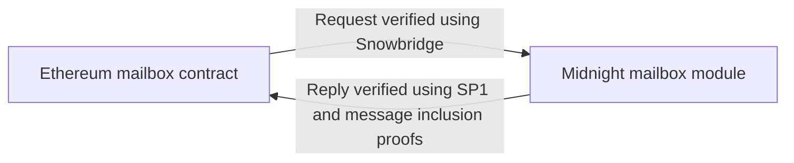
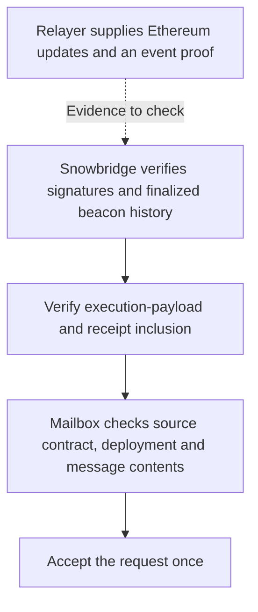
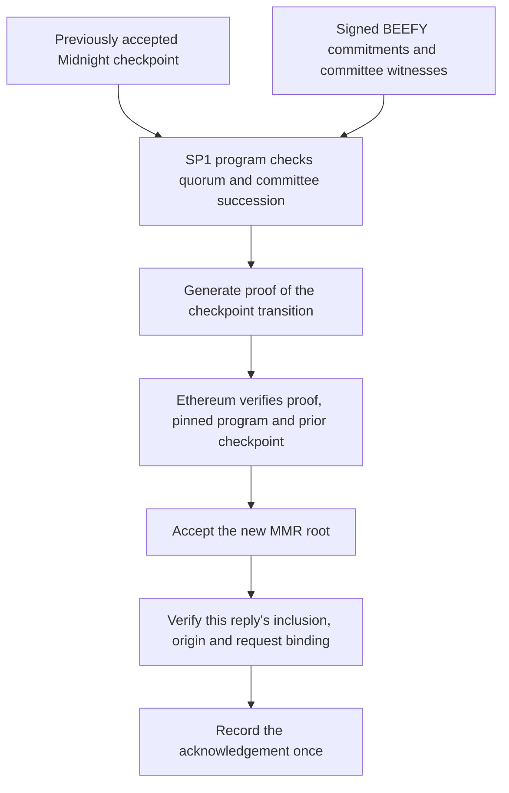
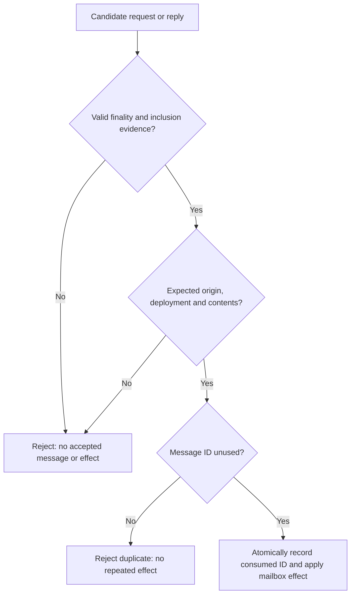

# A simple bridge between Ethereum and Midnight

Ethereum and Midnight are separate blockchains. An application on one chain needs evidence before it can act on something that happened on the other.

The proposal is a **two-way message bridge**: send a request from Ethereum to Midnight, then send a verified reply back. Each chain checks cryptographic evidence that the message was recorded and confirmed on the other chain. This small proof of concept gives us a foundation for applications that span both networks.

## How the two directions work

- **Ethereum → Midnight uses Snowbridge**, whose light-client components authenticate Ethereum's finalized history and events.
- **Midnight → Ethereum uses SP1**, a zero-knowledge virtual machine that proves a verification program ran correctly. A Midnight-specific program authenticates finality; Ethereum then checks the particular reply's inclusion.

The first application is a “mailbox” on each chain: a small contract or module that records messages and whether they have been acknowledged.

### Reusing Snowbridge

Midnight runs Snowbridge's Ethereum beacon light client. It verifies **BLS sync-committee signatures, committee updates and finality proofs** to accept Ethereum headers. Execution-payload and receipt-inclusion proofs then connect the exact event to that accepted history.

The mailbox additionally checks the emitting contract, bridge deployment, message ID and payload. A relayer-supplied event or transaction hash alone cannot authorize a request. The adaptation is the Midnight mailbox and routing layer around this verification path. [Snowbridge verification design](https://docs.snowbridge.network/architecture/verification/ethereum)

*Each step binds the request to the previous one: finalized Ethereum history → execution receipt → exact mailbox event → accepted request.*

### Reusing the SP1 and Avail approach

We follow [Avail Vector's prover/light-client pattern](https://github.com/availproject/sp1-vector/blob/c649310e79de376926863504d49eddbf09532980/contracts/src/SP1Vector.sol) and use [Succinct's unchanged proof verifier](https://github.com/succinctlabs/sp1-contracts/blob/d3629729c3216eb51bd4859d027a8eb729399fa4/contracts/src/ISP1Verifier.sol). The verification program is specific to Midnight's **BEEFY finality protocol**, rather than Avail's consensus. Avail's network is not part of the message path.

The program checks signatures from **strictly more than two-thirds of validator slots**, authenticated committee succession, and committee witnesses against signed **Merkle Mountain Range (MMR) roots**, which commit to message roots and committee snapshots. The Ethereum receiver pins the program key, verifier and genesis identity; each update must extend its stored checkpoint and advance the block height. Only a verified proof publishes a new root. The mailbox separately proves the reply's inclusion under that root.

*The SP1 proof authenticates a checkpoint. The separate inclusion and mailbox checks authenticate the particular reply. Both are required.*

## The components

- **Ethereum contracts** publish requests, verify Midnight proofs and record replies.
- **A Midnight runtime module** verifies Ethereum requests, records each one once and commits replies into Midnight's authenticated message history.
- **Relayer and prover services** collect evidence, generate proofs and submit transactions. They carry the messages; verification on the destination chain determines whether to accept them.

## The first demo

1. Someone submits a request ID and a hash identifying its contents on Ethereum.
2. Midnight verifies the finalized event and records “received.”
3. Midnight records a reply containing the same ID and hash.
4. Ethereum verifies the reply's finality and inclusion proofs, then records “acknowledged.”

Messages carry identifiers for the bridge deployment and a unique sequence number to prevent reuse. Message data is public; using SP1 does not make this exchange private.

## The invariants we must preserve

- **Authentic contents:** accepted source chain, contract, request ID and payload must all match the evidence; an acknowledgement must match its original request.
- **At most one effect per message:** recording a consumed ID and applying its effect happen atomically. Resubmission cannot repeat the effect.
- **No verification bypass:** invalid proofs cannot advance accepted bridge state; relayer outages and timeouts cannot authorize messages. Checkpoints cannot roll back or install an unannounced committee.
- **No asset mutation:** mailbox handlers have no mint, burn, custody or native-ledger-write capability. Proof/message sizes and execution costs must remain bounded within chain resource limits.

*These are the message-acceptance gates; proof bounds and checkpoint/committee checks happen inside verification. A missing proof leaves work pending, without authorizing an effect.*

These are acceptance requirements, not a blanket claim that reuse proves correctness. Security still depends on source consensus, cryptography and authenticated bootstrap checkpoints. A relayer can be served a valid older history instead of the current tip, so independent freshness monitoring remains necessary.

## Keeping the scope small

Build the mailbox endpoints and connect the verification and relay services on fresh local networks. The first demo needs no token custody, native token issuance or Compact application. Compact is Midnight's smart-contract language; application integration can follow once messaging works.

Success means a real round trip works, altered or repeated messages are rejected, replies work across a validator-session transition, and restarting a relayer completes pending work. Deployment to an existing network requires a separate compatibility and upgrade review.

There is concrete starting evidence: the [existing local token PoC](../../tests/snowbridge/sp1/README.md#validated-committee-protection--2026-10-26) exercised both proof paths, real Groth16 verification, tampering/replay rejection and a session rotation. That live run used one validator key; changed membership and the new mailbox application still need live validation.

## Bonus follow-on: tokens

The same proof infrastructure can support a token bridge: **lock an Ethereum token → issue a corresponding native Midnight asset → use it in Compact → permanently lock that representation in a redemption escrow → release the original token on Ethereum.**

This adds custody contracts, ledger and wallet integration, supply accounting, safe payout retries and security review. It is a follow-on application with additional responsibilities on top of the message bridge.

Its additional invariants are custody backing, one issuance per deposit, and at most one payout per funded retirement. A timeout alone must never authorize a replacement payout or refund.
