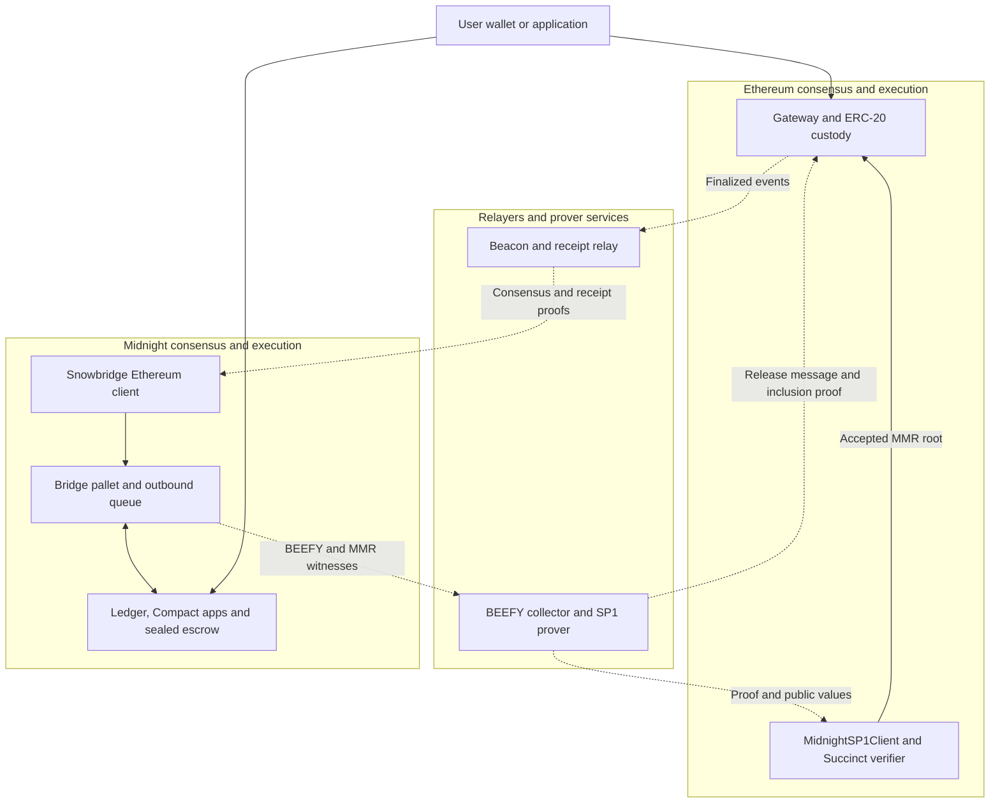
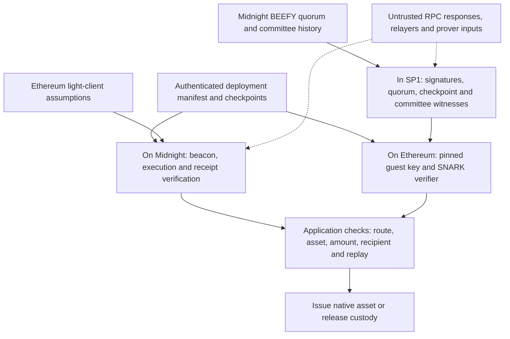
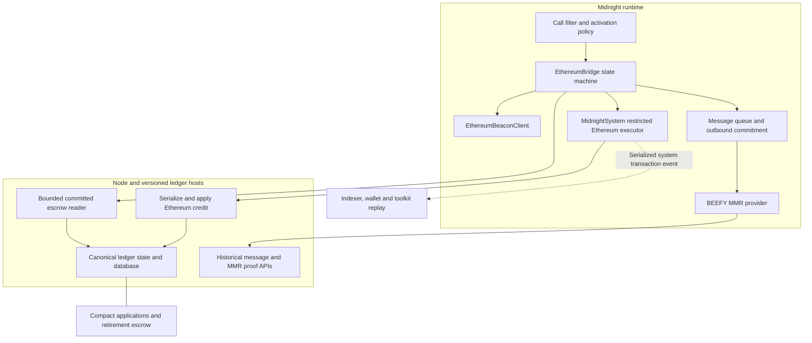
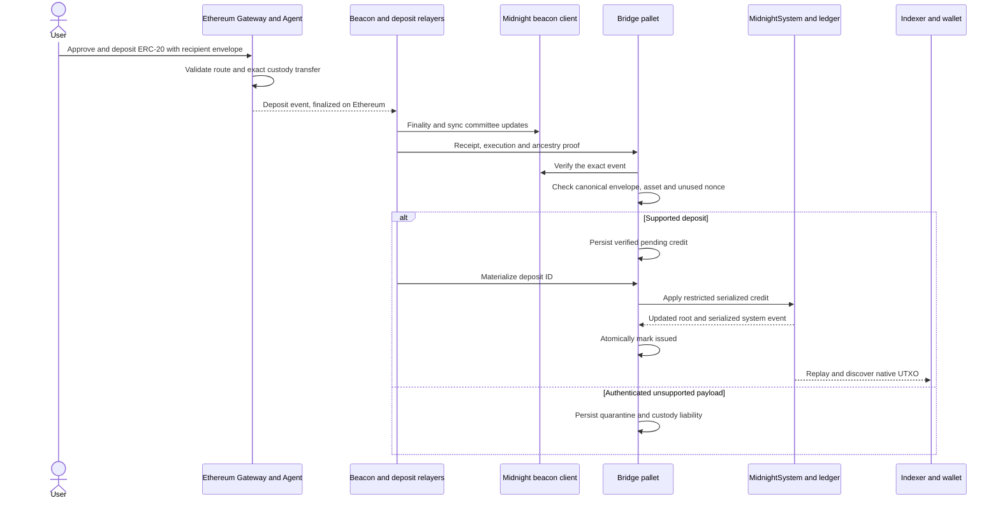
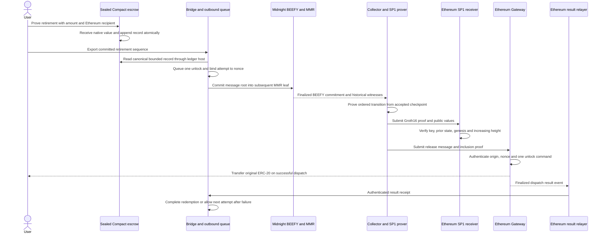
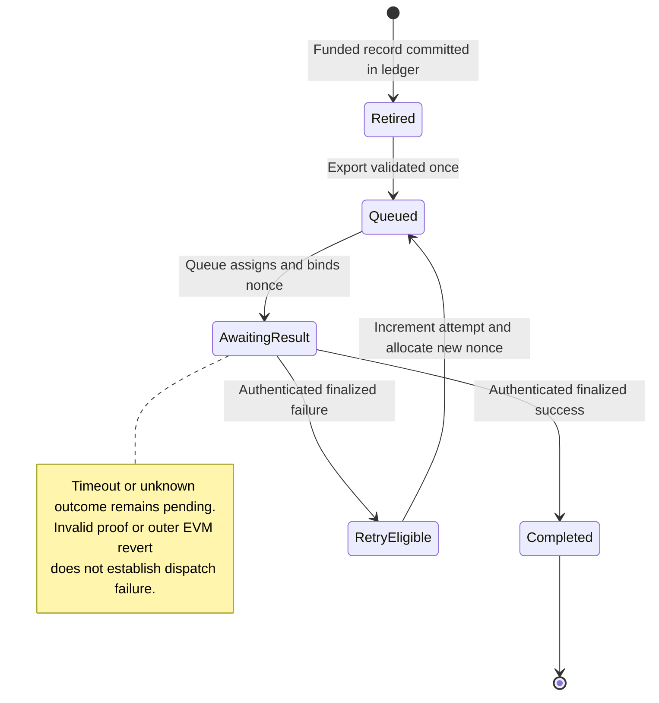
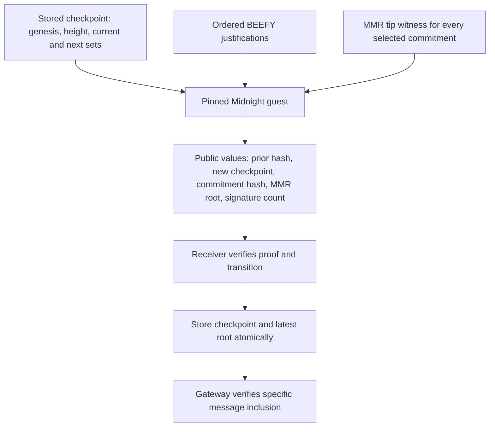
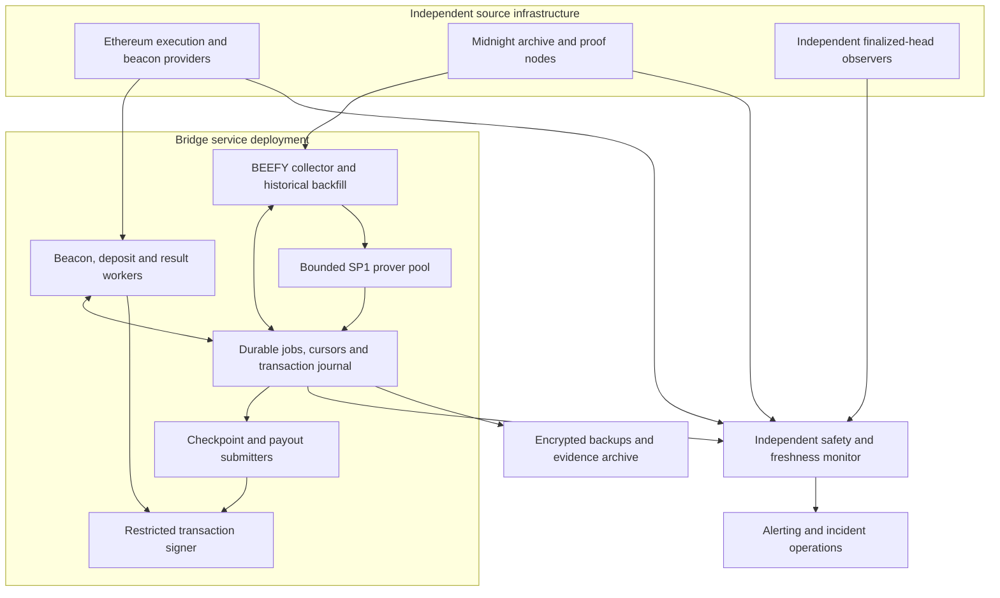
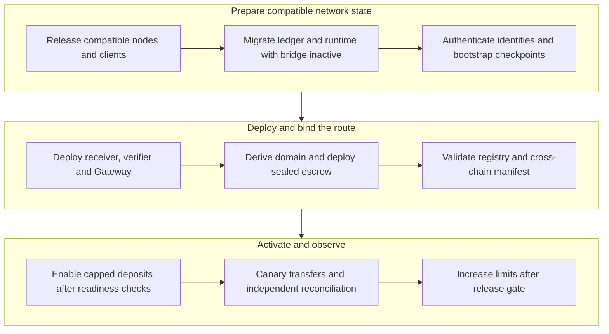

# Midnight Ethereum bridge production architecture

Architecture review draft • 28 October 2026

Midnight can bridge an allowlisted Ethereum ERC-20 into native unshielded ledger assets by combining Snowbridge verification for Ethereum events with SP1 verification of Midnight BEEFY finality on Ethereum. The local implementation demonstrates the complete token lifecycle. A supported deployment also requires coordinated ledger and client releases, an existing-chain migration, production proof services, authenticated bootstrap procedures, and explicit upgrade and incident policies.

This design proposes a bounded first production release for one conventional ERC-20 on one Ethereum network and one Midnight network. It supports normal production validator membership changes and sustained operation; the PoC's single-validator and lifetime capacity limits are not acceptable launch constraints. Multi-asset service, arbitrary cross-chain calls, shielded bridge entry and exit, native ETH, and fee-on-transfer or rebasing tokens are separate extensions.

**Review decisions:** approve the proof and custody boundaries; select the production authority/MMR profile; select immutable deployment or governed upgrade policy; agree the supported network and token; fund the cross-repository migration and operating model. The [work breakdown](snowbridge-sp1-production-work-breakdown.md) maps these decisions to delivery packages and release gates. Proposals below describe the target; tables explicitly identify current PoC behavior.

## 1 Executive architecture

The bridge locks the original token in Ethereum custody and creates a corresponding asset in Midnight's ledger. Users can hold that asset in wallet UTXOs or use it in ordinary Compact contracts. To redeem, they permanently lock the representation in a sealed Compact escrow. Midnight commits a release instruction, SP1 proves the relevant BEEFY checkpoint transition, and the Ethereum Gateway verifies message inclusion before releasing the original token. A finalized Ethereum dispatch receipt closes the redemption on Midnight or permits a new attempt after a proven failure.



*Figure 1. System context. Dotted arrows carry evidence. Relayers pay transaction costs and provide availability; their signatures do not authorize issuance or payout.*

The bridge does not route through Polkadot, Asset Hub, or Avail. Snowbridge supplies reusable components adapted to a standalone chain. SP1 proves the Midnight-specific verifier program; it does not execute Compact application proofs, validate arbitrary Midnight state transitions, or replace Midnight consensus.

## 2 Current implementation and production boundary

The recorded runs used node revision `5b9e6724ad0abc1570d43b66b7d568ee4511faf6` plus the then-uncommitted bridge implementation. This branch contains the implementation, dependency patches and build scripts. The [public evidence snapshot](../../tests/snowbridge/evidence/README.md) preserves historical results and explains their provenance; it does not attest a newly built commit. The latest saved acceptance profile is described in the [SP1 runbook](../../tests/snowbridge/sp1/README.md), dated 26 October 2026. The finite local run used Geth/Lodestar and one Midnight validator with development Cardano observation. It is distinct from a deployed network service.

| Area | Implemented and locally validated | Required production change |
| --- | --- | --- |
| Ethereum ingress | Real beacon/receipt verification; canonical deposit decoding; pending issuance; replay checks | Selected network fork compatibility, continuous relay, capacity and quarantine policy |
| Native issuance | Serialized `CreditEthereumAsset`; dedicated system executor; persistent deposit marker | Supported ledger release, serialization contract, client adoption and existing-state migration |
| Compact | Native asset receive/query/send; sealed retirement escrow | Supported compiler and schema, scalable retirement storage, actual application authorization |
| Outbound transport | SDK queue, nonce binding, standalone MMR/message proofs | Multiple messages per block, historical API and archive guarantees, measured throughput |
| SP1 finality | Real Groth16 proofs; checkpoint binding; committee succession and MMR tip checks | Live changed membership, production committee scale, reproducible Linux builds, capacity planning |
| Ethereum settlement | Adapted V2 Gateway; one unlock command; authenticated failure/retry/completion | Audited deployment and privileges, funded relay, emergency controls and lifecycle policy |
| Recovery | Saved proof jobs, historical justification recovery, finalized transaction reconciliation | Whole-service restart, reorg handling, independent failover, backups and operator drills |
| Limits | 64 deposits, 64 retirements, at most four attempts per redemption, one asset, one outbound message per block | Sustainable resource policy without dropping backing liabilities or replay history |

The saved test deposited 100, issued 100, exercised Compact operations, retired 40, verified an intentional failed payout, retried, paid 40, and authenticated completion. Final values were custody 60, recipient 40, consumer 60, retirement escrow 40, and wallet 0. SP1 proof times were 224.91 and 278.74 seconds; root-update transactions used 311,458 and 291,570 gas. These are single-validator local measurements of proof production and root updates, not end-to-end service targets or total transfer costs.

## 3 Requirements and scope

### Functional requirements

1. Accept only authenticated deposits for the configured network, Gateway, asset, amount and Midnight recipient; materialize each at most once.
2. Produce assets usable through the normal ledger, supported wallet tooling, and Compact operations, with exact integer base units.
3. Require a committed, funded retirement before exporting a release instruction. Allow at most one successful Ethereum payout per redemption.
4. Preserve safe retry after a finalized authenticated dispatch failure. Keep unknown outcomes pending.
5. Follow Ethereum sync committee changes and Midnight BEEFY membership changes without an operator supplying a replacement authority list.
6. Reconstruct issuance, balances, retirement records and redemption status through supported replay and recovery tools.
7. Expose a correlated transfer status without treating proof submission, EVM outer transaction success, or Midnight extrinsic success as asset settlement by themselves.

### Quality requirements to quantify before release

| Requirement | Required measurement or policy |
| --- | --- |
| Safety | State invariants in section 8 hold under concurrency, failures, replay and migration |
| Capacity | Maximum validator count, rotation frequency, messages per block, transfers per day, input bytes and storage growth |
| Latency | Separate p50/p95 deposit issuance, payout and completion receipt latency, including both finality waits |
| Availability | Agreed service SLO and independently monitored maximum checkpoint lag; consensus outages excluded or reported explicitly |
| Recovery | Agreed RPO/RTO, archive retention and longest recoverable downtime across committee transitions |
| Economics | Gas and DUST funding policy, proof compute budget, worst-case retry reserve and backlog drain capacity |
| Compatibility | Network/fork matrix, supported node/ledger/client versions, compiler/schema and guest/verifier identities |

The values are release-blocking inputs in decision D10, not implied by the PoC. The target must handle the intended production committee and workload; merely raising hard-coded caps is insufficient.

## 4 Trust boundaries and consensus assumptions



*Figure 2. Evidence crosses an untrusted transport boundary before protocol and application checks authorize value movement.*

**Ethereum to Midnight.** The Snowbridge light client authenticates beacon updates using sync committee signatures and finality/ancestry proofs, then binds execution receipts to accepted headers. This carries the light client's assumptions, bootstrap trust and fork compatibility requirements; it should not be described as validating every Ethereum transaction or inheriting the full validator set's security without qualification. [Snowbridge Ethereum verification](https://docs.snowbridge.network/architecture/verification/ethereum)

**Midnight to Ethereum.** The guest checks a strict supermajority of BEEFY validator **slots**, `q(N) = N - floor((N-1)/3)`, against authenticated current/next committee commitments. Stake values appear in payload commitments; they do not make the inspected quorum stake weighted. The production design must demonstrate that this matches the actual signing and committee-selection rules. BEEFY evidence is authenticated by the source quorum; the guest does not independently reexecute the source ledger or establish Cardano validity. Midnight's existing equivocation reporting configuration must be assessed explicitly; Polkadot slashing assumptions do not transfer automatically.

**Cryptography and software.** SP1 soundness, the chosen proof system's setup assumptions, cryptographic libraries, guest correctness, Solidity decoding, and reproducible guest/verifier identity are separate dependencies. Ethereum invokes the standard `verifyProof(programVKey, publicValues, proofBytes)` boundary. A correct SNARK verifier can still accept an unsafe application if the wrong guest key or state transition is configured. [Pinned SP1 interface](https://github.com/succinctlabs/sp1-contracts/blob/d3629729c3216eb51bd4859d027a8eb729399fa4/contracts/src/ISP1Verifier.sol)

**Bootstrap and freshness.** Each light client starts from authenticated state. Ethereum bootstrap and recovery procedures must account for checkpoint age and weak subjectivity. [Ethereum consensus checkpoint guidance](https://ethereum.github.io/consensus-specs/specs/phase0/weak-subjectivity/) Midnight bootstrap must independently authenticate genesis and current/next committees. The existing one-key bootstrap is a fixture, not a production committee discovery algorithm.

Committee witnesses prevent substitution and rollback within the checked history. They do not prove source-tip freshness: an isolated relayer can receive an old valid prefix or no new data. Independent source connections, checkpoint-lag monitoring and an explicit stale-service policy are required. Any on-chain expiry would be a new authenticated-time design, not something operators can infer from the present block-height checks.

**Governance.** Runtime governance and any future EVM upgrade, pause, registry or checkpoint authorities can change the trust model. The current receiver has immutable verifier/key/genesis and exposes no guardian override. Production powers must be explicitly enumerated and audited; this design grants no arbitrary mint, payout or checkpoint replacement power by implication.

## 5 Components and ownership boundaries



*Figure 3. Runtime coordination is separate from ledger execution. Compact does not independently mint the bridged color.*

| Component | Owns | Must not do |
| --- | --- | --- |
| Ethereum Gateway and Agent | Exact token custody, route policy, message verification, command dispatch and results | Permit arbitrary agents, tokens or release commands through this route |
| Midnight SP1 receiver | Destination checkpoint, accepted MMR root, fixed program and verifier identities | Accept relayer-selected trust anchors or publish state before proof validation |
| SP1 guest | BEEFY decoding, signatures, slot quorum, ordered checkpoint transition and runtime committee witness checks | Treat current RPC lists or payload roots as self-authenticating |
| Ethereum beacon client | Finalized beacon/execution state and event-proof verification | Authorize a token credit based only on event bytes |
| Bridge pallet | Frozen route configuration, deposits, quarantine, exports, attempts and receipt state | Mint caller-supplied values or infer failure from timeout |
| MidnightSystem and ledger hosts | Restricted credit application, canonical root, event serialization, block costs and fixed escrow reads | Widen Cardano/governance system privileges or mutate invisible ledger state |
| Ledger | Asset outputs, deposit replay protection, contract state, accounting and serialization | Expose unrestricted bridge issuance to ordinary users |
| Compact escrow | Atomic receipt and immutable retirement record | Spend, refund, mint or upgrade retired funds |
| Relayer/prover service | Durable evidence collection, jobs, transaction submission and finality reconciliation | Turn endpoint trust or service database entries into transfer authorization |
| Wallet/indexer/toolkit | Replay, discovery, balances, transaction composition and user status | Skip unknown system variants or confuse retired escrow with spendable supply |

## 6 Transfer protocols

### Ethereum deposit and native issuance



*Figure 4. Admission and materialization are separate durable steps, so temporary ledger capacity failure does not lose a deposit.*

The asset amount comes from the authenticated asset event, not from the recipient envelope. The PoC uses a canonical 96-byte ABI envelope `(uint8 version, bytes32 bridgeDomain, bytes32 recipient)` and one asset. Recipient bytes identify an unshielded user address; UI validation must prevent confusion with shielded or contract addresses.

`materialize_deposit` accepts a deposit identity, reads its stored fields, and invokes the dedicated Ethereum system capability. Updating the canonical ledger root, publishing the serialized system event and marking issuance must be atomic. Persistent replay markers remain after the issued output is spent. Host database writes, FRAME rollback, block fullness and post-block updates require verification in both supported database modes.

Authenticated but unsupported messages remain visible liabilities in quarantine. Invalid cryptographic proofs do not enter that stream. Recovery from quarantine needs a separately specified policy; a generic root mint or discretionary refund is not part of this design.

### Midnight retirement and Ethereum release



*Figure 5. Proof of finality and proof of message inclusion are separate checks. The Compact asset is permanently locked before either is submitted.*

Retirement is permanent locking, not a ledger burn. The escrow must be sealed in committed ledger state, expose exactly the approved operation, and have no maintenance, mint, send or refund path. The host reader pins the compiled operation hash and schema and checks amount, recipient, color, domain, sequence and backing balance. A future compiler cannot change this layout without a versioned accessor and deployment transition.

The PoC consumer is a permissionless test contract; its `withdraw` function is not a production authorization model. Real applications must supply their own ownership and spending checks. The tested consumer-to-escrow route passes through a wallet UTXO; direct contract composition needs its own acceptance fixture.

### Redemption state and failure semantics



*Figure 6. `Retired` is a logical ledger condition; the inspected pallet enum begins at `Queued`. A proven conflicting result also triggers the pallet's outbound safety halt.*

Gateway outer transaction success can contain a caught command failure and consume the message nonce. The result relay must select the exact Gateway dispatch event and match topic, nonce and recorded attempt. The SDK reward receipt bookkeeping alone does not establish payout success. A failed authenticated attempt permits a new nonce; an invalid proof or outer transaction revert normally leaves the same attempt pending. No receipt means unknown, even after a long delay. Keep one unlock command per message so a failure cannot hide partial payout in a command batch.

## 7 Proofs and protocol identities

### SP1 state transition



*Figure 7. Every committee transition is connected to the stored destination checkpoint. Proving a valid root does not authenticate unrelated message calldata.*

The guest verifies the complete signed SCALE commitment and strict slot quorum, ordered block heights, current-set authentication and promotion only of an announced next set. Each selected commitment has a proof of the last runtime MMR leaf under its signed `mh` root. That leaf's parent number must be the signed block minus one, and its next-set commitment must match the signed successor after the explicit authority-format conversion.

There are three distinct profiles: the normal runtime's compressed public keys; the PoC runtime MMR's 20-byte Ethereum addresses; and the PoC `cb`/`nb` payload's Ethereum addresses plus little-endian u64 stake. These roots are not interchangeable. D02 must choose whether production migrates the runtime format or uses a new guest for the normal profile. There must be no witness-controlled fallback accepting both.

At a live session boundary, the first block's runtime MMR snapshot can lag the newly signed successor payload. The current collector defers that target until a later authenticated commitment agrees; it does not relax the guest equality checks. Production must test changed keys, counts, uneven stake data, skipped source observations and multiple rotations, including real Cardano/partner-chain authority inputs.

The inspected guest accepts up to 64 ordered justifications and one witness per justification, with a 4 MiB encoded input limit. Public output is canonical SCALE, 181 or 225 bytes depending on next-set presence. The Ethereum receiver checks exact encoding, previous checkpoint hash, genesis and increasing height, then verifies the SNARK before exposing the new root. The PoC uses SP1 SDK/guest 6.10.0 and Solidity verifier v6.1.0; these are pinned baseline identities, not a recommendation to install an unreviewed latest version.

### Message commitments and API versions

Outbound message roots are formed after queue processing and appear in a following MMR leaf. The implemented standalone leaf is fixed-width 113 bytes and uses raw version byte `0x20`. Existing source comments describe the version inconsistently; the normative specification must pin bytes and test vectors rather than copy those labels. The proof pipeline must agree on message block, following leaf, parent number, MMR activation offset, leaf count and historical state.

The receiver stores only the latest root. A competing accepted update can invalidate an older inclusion proof submission; the service must rebuild the inclusion proof against the new accepted root or D09 must adopt bounded root history. It must never bypass verification to resolve that race.

Node behavior must negotiate runtime API versions. Runtime dependence on new host semantics must use a new or versioned host import that an older node cannot instantiate. A guessed `spec_version` activation threshold is prohibited by the repository's rules. Rebuild metadata after storage, extrinsic or runtime API changes.

### Domain separation and wire contract

| Identity | Binding in the PoC | Production rule |
| --- | --- | --- |
| Bridge domain | Ethereum chain ID/genesis, Gateway proxy, Midnight genesis, deployment salt | Authenticate manifest values and reject wrong-chain initialization |
| Asset ID and color | Domain plus ERC-20, then actual Compact token derivation with escrow address | Never authorize by symbol or decimals; pin derivation vectors |
| Deposit ID | Domain and inbound nonce | Retain content digest and consumed marker after output spend |
| Output intent | Deposit, asset, color, amount and recipient | Derive deterministically using normative typed encoding |
| Redemption ID | Domain, escrow address and sequence | Stable across retry attempts |
| Attempt and message nonce | Redemption, attempt number, queue-assigned nonce and message hash | One active attempt; immutable result association |
| SP1 checkpoint | Genesis, height and authenticated current/next sets | Previous checkpoint hash must match receiver storage |

Keccak-256, Solidity ABI and SCALE have different rules. Use typed, versioned test vectors across Rust, JavaScript, Compact and Solidity. Do not substitute packed ABI hashing or NIST SHA3. Identifiers in the [draft implementation specification](snowbridge-implementation-spec.md) are the starting point; production vectors must be generated from the final code.

## 8 Accounting and safety invariants

For a causally consistent cut of finalized Ethereum and Midnight histories, define per asset:

```text
D = exact supported deposits into Ethereum custody
M = materialized native value
R = permanently retired native value
U = successful finalized Ethereum releases
C = spendable native value, excluding retirement escrow
P = D - M  deposited but unmaterialized value, including quarantine
Q = R - U  retired value awaiting successful release
X = independently identified unsolicited surplus

C = M - R
custody = D - U + X = C + P + Q + X
P >= 0 and Q >= 0
```

The monitor must count successful releases even while their completion receipts are still in transit to Midnight. Two arbitrary latest heads do not form a valid accounting cut. Donations must be independently identified as `X`; treating every unexplained residual as surplus would hide theft or accounting defects. Native retirement balances remain in total ledger holdings and cannot be counted as spendable backing claims.

Required invariants are exact recipient/color/amount binding, one issuance per deposit, one payout per redemption, funding and record creation in the same committed segment, permanent replay protection, no independent minting of the color, and terminal completion. The oracle must derive expected results from independently observed effects and causal identities, rather than reuse bridge counters as its expected answer.

## 9 Service deployment and operations



*Figure 8. Proposed production deployment. Redundant collection is compatible with a coordinated transaction writer; writer failover requires leases and fencing.*

Use separate worker identities for evidence collection, proof production, transaction spending and governance. A transaction key is a gas-paying capability and must never become a proof bypass. Provider diversity should include independently operated infrastructure, not several URLs backed by one operator.

Persist source observations separately from accepted destination checkpoints. Each proof job pins its input checkpoint, source range, exact witness bytes, guest identity, proof and public output. Save the transaction identity before broadcast; reconcile replacement, dropped and uncertain transactions against canonical finalized chain state before advancing cursors. Concurrent writers must avoid signing-nonce collisions and checkpoint races.

Keep historical justifications, intermediate committee witnesses, message proofs, execution receipts and beacon ancestry available for the declared recovery horizon. Define proof-node indexing, archive pruning, backup and restore policies together. A current authority RPC response cannot replace a missing authenticated announcement. A database restore behind destination state must reconcile to chain state rather than replay local jobs blindly.

Monitor checkpoint age, independent source lag, sync committee period, proof queue age, job failures, message backlog, pending/quarantined liabilities, custody conservation, attempt outcomes, archive horizon, signer balances and runtime resource use. Correlate logs by domain, deposit/redemption/attempt identity, source block and destination transaction. Avoid storing user secrets or proof witness secrets in telemetry.

### Capacity and economics

Size proving at the production committee, rotation rate and history gap. For measured worker proof time `T` and `k` independent workers, nominal proof service capacity is `k/T`; actual throughput is constrained by ordered checkpoint dependencies, batching, submit latency and headroom. More workers do not automatically allow concurrent checkpoint updates. Measure CPU/GPU options and remote proving separately before selecting them.

Budget one root update per selected batch plus release gas, beacon updates, receipt submissions, Midnight transaction costs, Compact proving, retries, archive/RPC and operations. The baseline has operator-funded relay and zero protocol relay fees. A supported subsidy model needs funding reserves and abuse controls; adding reimbursement changes protocol accounting and needs its own review. DUST provisioning in the fixture does not establish a production fee experience.

## 10 Security and privacy review

| Threat or fault | Required control and response |
| --- | --- |
| Forged deposit or arbitrary issuance | Real light-client/event proof; canonical route checks; restricted host; permanent deposit marker |
| Unfunded retirement or upgraded escrow | Committed ledger read; sealed maintenance state; pinned operation/schema; atomic funding record |
| Committee substitution, rollback or root confusion | Authenticated current/next succession; every commitment's MMR tip witness; fixed authority profile |
| Valid but stale source prefix | Independent head observation, stale-service policy, authenticated recent bootstrap; alarm without fabricating a new checkpoint |
| Guest/verifier replacement or supply-chain compromise | Reproducible artifacts, code hashes, approved manifest, explicit key and verifier lifecycle |
| Double payout after uncertain result | Attempt/nonce binding, exact finalized result verification, no timeout retry or refund |
| Malicious token behavior | Conventional-token allowlist, custody delta checks, reentrancy/failure tests, issuer pause/blacklist review |
| Resource exhaustion | Measured weights/costs, proof and storage bounds, admission/rate controls preserving existing liabilities |
| Crash, provider loss or reorg | Durable journaling, archive backfill, finality reconciliation, fenced failover and restore drills |
| Privileged compromise | Enumerated powers, least privilege, separate pause/resume roles and audited change procedure |

Bridge amounts, Ethereum recipients, unshielded asset flows, retirement records and public proof outputs are public in this profile. SP1 is used to compress verified computation; it does not make the transfer private. Subsequent shielding or private application behavior requires separate product and linkability analysis.

Security review must cover the combined system: patched Snowbridge contracts, custom Gateway, SP1 guest and receiver, ledger capability and serialized variant, pallet/queue atomicity, bootstrap, migration and operating procedures. Upstream audits do not certify the composition or its modifications.

## 11 Deployment and upgrade lifecycle

### Initial activation



*Figure 9. Proposed production activation. Prevent custody acceptance during the setup window; the PoC currently relies on its local driver to keep users out of that window.*

Derive chain identities first; deploy the receiver from an authenticated checkpoint, then Gateway/executor/proxy with atomic initialization. The bridge domain depends on the proxy address. Derive the token namespace, deploy the sealed escrow, derive the actual color from its address, and validate its initial committed state before activating the registry. This avoids circular address/genesis dependencies. Production needs an explicit deposit-enable mechanism or equivalent auditable admission control; the disposable script's sequencing is not enough.

### Existing chain migration

Release the ledger variant and host-capable node before the runtime calls those imports. Coordinate wallets, indexers and toolkits before issuance. Verify old snapshots, existing balances, replay markers, normal Cardano bridge behavior and unrelated MMR consumers across the migration. Rehearse migration on representative state and validate both cold replay and snapshot recovery. The current migration patch only makes the new state shape compile.

Choose the production authority conversion and MMR activation boundary in D02. Existing proof clients may depend on the old raw-key roots and leaf format. Define how old proofs remain verifiable and where new proofs start; changing a feature flag is not a live-network migration plan.

### Guest and custody upgrades

The current receiver's program key and verifier are immutable, and the Gateway's client address is fixed. A new guest key therefore requires a fresh receiver and an explicit Gateway/custody/domain migration design; compiling a new ELF does not upgrade a running receiver. A replacement proxy/domain or escrow also changes asset identity. Options are immutable versioned routes with controlled draining, or narrowly governed upgrades with explicit trust and delay policies. D03 selects one before mainnet work is finalized.

### Pause and recovery

Pause actions must distinguish new Ethereum deposits, new Midnight issuance, new retirements/exports, root updates, payouts and result receipts. A pause that blocks all receipts can prevent safe resolution of existing transfers. For each incident class, define the smallest effective halt and which draining operations remain safe. The PoC's conflict-triggered outbound halt is not a full incident framework.

On-chain irreversible transitions cannot be undone by redeploying older binaries. Before activation, abort by leaving ingress closed. After custody or native issuance exists, reconcile liabilities, preserve the old route and recovery evidence, and execute the approved drain/forward-fix/migration procedure. Automatic refunds and emergency arbitrary minting are not assumed recovery tools.

## 12 Architecture decisions

| ID | Decision and recommended starting point | Blocking consequence | Work package |
| --- | --- | --- | --- |
| D01 | Select network pair and one conventional ERC-20; document decimals and issuer controls | Real fork fixtures and token behavior must pass before public testing | W01.1, W07.4 |
| D02 | Select authority profile and versioned MMR migration; preserve existing consumers | Guest key, node compatibility and rollout depend on exact bytes | W01.3, W05.1 |
| D03 | Choose immutable routes or governed upgrades; enumerate every privileged action | Determines custody migration, pause design and audit scope | W01.5, W07.6 |
| D04 | Approve authenticated bootstrap and stale-service policy | Defines operator trust and safe restart after long downtime | W01.4, W08.5 |
| D05 | Select supported ledger serialization, compiler/schema and client release train | Current patched build cannot become a supported release by packaging alone | W02.1, W06.1, W11.1 |
| D06 | Define sustainable retention, escrow capacity and exhausted-attempt resolution | Removing 64-record/four-attempt caps requires cost and liability policy | W01.6, W04.5, W06.3 |
| D07 | Select operator subsidy or explicit fee mechanism and signer funding model | Controls economic availability and user fee experience | W12.1, W12.2 |
| D08 | Select single coordinated writer with fenced failover; separate proof and relay workers | Concurrency, replacement transactions and crash recovery must be tested | W10.3, W13.3 |
| D09 | Retain latest-root verification with proof regeneration initially; evaluate bounded root history if needed | Changes relay scheduling or receiver storage/audit scope | W07.3, W10.4 |
| D10 | Agree validator/workload envelope, SLO, RPO/RTO, exposure limits and expansion criteria | No launch gate can close while its numeric acceptance criteria are blank | W01.2, W13.1, W17.1 |
| D11 | Define quarantine and stranded-retirement recovery without proof bypass | Unsupported locked value and exhausted attempts remain liabilities | W04.4, W07.7 |
| D12 | Select independent external audit scope and release signoff roles | Security and operations approval required before funded production activation | W14.1, W16.7 |

## 13 Validation and rollout gates

| Gate | Required evidence | Meaning |
| --- | --- | --- |
| G0 Scope and protocol frozen | D01–D12 resolved where needed; normative vectors; source and artifact manifest | Implementation has a reviewable contract |
| G1 Supported build and replay | Upstreamed ledger dependencies; reproducible artifacts; both DB modes; client replay; migration rehearsal | New state can be operated on an existing chain |
| G2 Production-shaped private network | Multiple validators with changing membership; production workload; real PoS proofs; fault and recovery matrix | Protocol works beyond the fixture |
| G3 Selected public testnet | Actual selected-network forks, continuous service, wallet/indexer paths, funding and incident drills | External-network operation demonstrated |
| G4 Security and operations readiness | Independent audit findings resolved or explicitly accepted by authorized risk owners; restore/failover; signed deployment manifest | Capped production activation can be considered |
| G5 Capped production pilot | Verified configuration; exposure limits; canary round trips; independent accounting and observation window | Real liabilities remain within the pilot envelope |
| G6 General availability | Pilot criteria met; incidents closed; capacity/economic evidence; support and on-call ownership | Expand only to approved limits |

Moving between gates is a release decision, not a calendar event. A fork incompatibility, conservation violation, unsupported client replay or unsafe migration blocks progression. Numerical pilot limits and observation periods are selected in D10.

## 14 Source map and presentation guide

| Topic | Repository evidence |
| --- | --- |
| Overall implementation and local profile | [Main runbook](../../tests/snowbridge/README.md), [existing diagrams](../../tests/snowbridge/ARCHITECTURE.md), [handoff](../../SNOWBRIDGE_HANDOFF.md) |
| Runtime integration and limits | [Runtime wiring](../../runtime/src/ethereum_bridge.rs), [runtime assembly](../../runtime/src/lib.rs), [bridge state machine](../../pallets/ethereum-bridge/src/lib.rs) |
| Ledger authorization and replay | [Host functions](../../ledger/src/host_api/ledger_9.rs), [MidnightSystem](../../pallets/midnight-system/src/lib.rs), [ledger patch](../../tests/snowbridge/patches/ledger.patch), [migration patch](../../tests/snowbridge/patches/migration.patch) |
| Compact retirement and schema | [Escrow source](../../tests/snowbridge/compact/escrow.compact), [consumer fixture](../../tests/snowbridge/compact/consumer.compact), [committed state reader](../../ledger/src/ledger_9/ethereum_bridge.rs) |
| Ethereum custody and verification | [Gateway](../../tests/snowbridge/contracts/src/MidnightGateway.sol), [receiver](../../tests/snowbridge/contracts/src/MidnightSP1Client.sol), [upstream patch](../../tests/snowbridge/patches/upstream.patch) |
| SP1 protocol and recovery | [Guest verifier](../../tests/snowbridge/sp1/beefy/src/lib.rs), [committee witness verifier](../../tests/snowbridge/sp1/beefy/src/committee.rs), [SP1 runbook](../../tests/snowbridge/sp1/README.md), [relayer](../../tests/snowbridge/sp1-relay.mjs) |
| Protocol detail and acceptance model | [Implementation specification](snowbridge-implementation-spec.md), [E2E strategy](snowbridge-e2e-testing-strategy.md), [runtime and ledger spike](snowbridge-runtime-ledger-integration-spike.md) |
| Saved local acceptance evidence | [Latest validation report](../../tests/snowbridge/evidence/run-mjrg6180.validation.json); raw local artifacts require a separate archive, as described in the [evidence guide](../../tests/snowbridge/evidence/README.md) |

For a 30–45 minute architecture review, use Figure 1 and section 2 to establish scope; Figures 2–3 for trust and component ownership; Figures 4–7 for transfer and proof semantics; section 8 for conservation; Figures 8–9 for operations and rollout; and section 12 for decisions. Keep the full work breakdown available for dependency and staffing discussion. The source document contains nine editable Mermaid diagrams; the companion HTML includes their rendered SVGs for browser presentation without network access.
