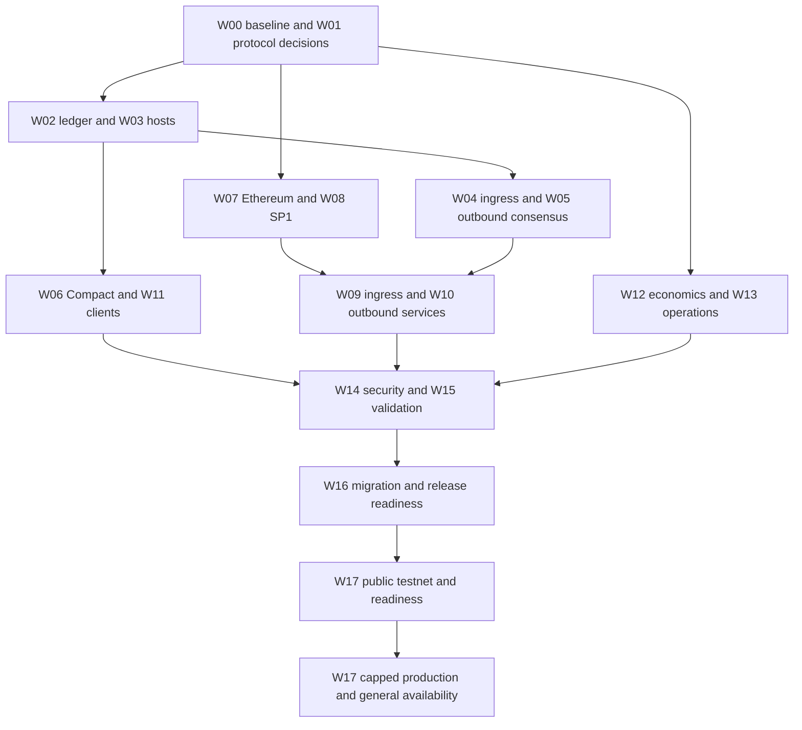

# Midnight Ethereum bridge development and rollout work breakdown

Delivery planning draft • 28 October 2026

The local Snowbridge/SP1 bridge proves the bidirectional token lifecycle. Full development now means turning that implementation into a supported protocol, migrating the ledger and clients, operating continuous proof services, and introducing real custody liabilities through controlled release gates. This plan covers those changes across node, ledger, Ethereum contracts, Compact, prover, relayers, clients, security and operations.

The companion [production architecture](snowbridge-sp1-production-architecture.md) defines boundaries, diagrams, invariants and decisions D01–D12. The first supported scope is one conventional ERC-20, one Ethereum network and one Midnight network, with real production committee changes and sustained operation. W18 lists extensions that must be separately approved. No task below authorizes deploying contracts, moving funds, publishing releases or changing a live network.

## 1 How to use the plan

Each row is a deliverable-sized work package suitable for issue decomposition. The **done** statement is the minimum reviewable acceptance artifact. **Depends on** identifies implementation inputs; a release gate also requires the integrated acceptance matrix in section 4. Proposed owners are disciplines, not assigned people or confirmed repository ownership.

**Baseline notation:** **H** means harden, integrate or extend a locally demonstrated capability; **N** means new production work; **D** means an unresolved design decision. H does not mean production complete. Every row starts open. Freeze protocol choices before estimating dependent packages. Parallel work means parallel engineering workstreams; it does not require any particular agent workflow.

**Priority:** W00–W17 form the supported launch program. Rows explicitly marked **GA** can follow a capped pilot only if its release review approves a compensating limit or procedure; otherwise they block that pilot too. W18 is post-launch scope. A failed safety, migration, fork or replay requirement cannot be waived merely by calling the release a pilot.

**Definition of done for every code package:** reviewed implementation; meaningful positive, negative and recovery tests at its boundary; updated compatibility/specification vectors where applicable; reproducible artifacts; measured resource limits; source and operational documentation; and evidence linked to the owning issue. Cross-repository packages close only after all required consumers use compatible published revisions.

## 2 Delivery phases and dependencies

| Gate | Exit deliverables | Primary packages |
| --- | --- | --- |
| G0 Protocol and scope | Production network/token, trust policy, authority profile, schemas, invariants, powers and numeric service targets agreed | W00–W01, design inputs from W06–W08 and W12–W14 |
| G1 Supported build and migration | Published ledger dependencies; versioned hosts/APIs; cold replay and representative existing-state upgrade; reproducible manifests | W02–W03, W05, W06, W11, W15–W16 |
| G2 Private production-shaped network | Real changing validator membership, supported Ethereum consensus, sustained workload, fault injection and recovery | W04–W10, W12–W15 |
| G3 Selected public testnet | Actual fork compatibility; user client flow; continuous operation; funding, incident and upgrade drills | W07–W13, W15, W17.2–W17.4 |
| G4 Security and operations ready | Audit closure, manifests, production ceremony rehearsal, restore/failover and release signoff | W14, W16, W17.5 |
| G5 Capped production pilot | Verified deployed identities, enforced exposure limits, successful canaries, independent reconciliation and observation | W17.6–W17.7 |
| G6 General availability | Pilot expansion criteria met; support and on-call transfer; all GA requirements closed | W17.8–W17.9 |

*Implementation dependencies can overlap with early testing and threat analysis. Audit planning, observability and client contracts begin at G0; the arrows show integration readiness, not a requirement to postpone those activities.*

The likely critical dependency chain is authority/profile decision → supported ledger schema and hosts → runtime/client migration → production-shaped end-to-end tests → audit remediation → deployment rehearsal → capped production observation. Public-network fork incompatibility, unavailable client releases or audit capacity can become independent critical paths. Estimate dates only after these external dependencies have owners and commitments.

## 3 Work packages

### W00 Preserve and reproduce the implementation baseline

Proposed owner: node maintainer with release engineering. Target: G0, with reproducibility carried into G1.

| ID | Baseline | Deliverable and done criterion | Depends on |
| --- | --- | --- | --- |
| W00.1 | N | Capture tracked and untracked PoC source, patches, standalone lockfiles and exact base revision in a reviewable branch and source manifest. Exclude unrelated local work and credentials. A clean checkout can identify every required file. | None |
| W00.2 | H | Archive ignored evidence, dependency revisions, compiler/prover identities, contract ABIs and guest keys. Recheck saved hashes and store evidence in a durable controlled location, not only this workstation. | W00.1 |
| W00.3 | H | Reproduce the latest real bidirectional SP1 run without source changes. Record commands, environment, manifests and all final accounting values; distinguish reproduced results from inherited run claims. | W00.2 |
| W00.4 | N | Inventory external changes in midnight-ledger, state translation, Snowbridge, client packages and proof toolchains. Identify actual repositories, maintainers, license obligations and required release order. | W00.1 |
| W00.5 | H | Separate historical proposals, direct-Solidity baseline and current SP1 behavior. Publish a current specification index and resolve conflicting leaf-version comments with byte-level vectors. | W00.1 |
| W00.6 | N | Establish accountable owners, issue hierarchy, architecture review cadence and evidence storage. Each WBS package has an owning team, reviewer and linked issue before scheduling. | W00.4 |

### W01 Define the production protocol and scope

Proposed owner: protocol architect with product, consensus, security and operations. Target: G0.

| ID | Baseline | Deliverable and done criterion | Depends on |
| --- | --- | --- | --- |
| W01.1 | D | Resolve D01: choose network pair and token, base-unit semantics, issuer pause/blacklist behavior and excluded asset classes. Publish the supported-network and asset policy. | W00.4 |
| W01.2 | D | Resolve D10: quantify validator count, rotation frequency, workload, latency/SLO, RPO/RTO, history horizon and exposure limits. Each acceptance target has a number, measurement method and owner. | W01.1 |
| W01.3 | D | Resolve D02: choose raw-key or Ethereum-address authority profile, stake/slot semantics and exact standalone MMR bytes. Document migration impact on existing proof consumers and produce shared vectors. | W00.5 |
| W01.4 | D | Resolve D04: authenticate both bootstraps, checkpoint age rules, independent sources and stale-service response. Define who may bootstrap or recover without assuming a relayer's authority list is trusted. | W01.1, W01.3 |
| W01.5 | D | Resolve D03: enumerate pause, resume, registry, verifier, guest-key, custody and runtime powers. Select immutable versioned routes or governed upgrades, delays and separation of duties. | W01.3, W01.4 |
| W01.6 | D | Resolve D06: define sustainable replay retention, retirement capacity, attempt exhaustion, admission backpressure and archival commitments. Prove liabilities cannot be deleted to reclaim capacity. | W01.2 |
| W01.7 | H | Freeze normative domain/asset/deposit/output/redemption/attempt encodings, ABI/SCALE layouts, errors and state transitions. Rust, JS, Compact and Solidity consume identical positive and malformed-input vectors. | W01.1, W01.3 |
| W01.8 | H | Specify conservation, recipient binding, exactly-once effects, partial success, quarantine and no-timeout-refund properties. Review a reference state model covering every transfer state and failure. | W01.6, W01.7 |
| W01.9 | N | Define change control and compatibility policy for protocol versions, forks and ledger schemas. Approve the architecture decisions and release gate criteria with named organizational owners. | W01.2–W01.8 |

### W02 Release the ledger protocol extension

Proposed owner: ledger maintainers. External repository release required. Target: G1.

| ID | Baseline | Deliverable and done criterion | Depends on |
| --- | --- | --- | --- |
| W02.1 | H | Replace the experimental ledger patch with a supported serialized Ethereum-credit variant and supported state version. Define compatibility tags, decoding failures and release version; old clients cannot silently skip it. | W01.7, W00.4 |
| W02.2 | H | Harden credit validation for asset/color, recipient, exact amount, duplicate deposit and existing output. Demonstrate that ordinary users and unrelated system variants cannot independently create that color. | W02.1, W01.8 |
| W02.3 | H | Replace the 64-entry replay map policy with sustainable permanent consumed-deposit protection. Bound per-operation cost and migration/storage growth without resurrecting spent deposit IDs. | W01.6, W02.2 |
| W02.4 | H | Calibrate ledger cost accounting for issuance, persistent state, block accumulation and post-block processing. Worst-case valid credits cannot bypass fullness or overflow accounting. | W02.2–W02.3, W01.2 |
| W02.5 | N | Implement existing-state translation with representative historical ledgers. Preserve balances, treasury/Cardano/NIGHT/DUST semantics, contract state and roots under documented version transition rules. | W02.1–W02.4 |
| W02.6 | H | Publish deterministic serialization, event replay, snapshot and database fixtures. Genesis replay and snapshot-plus-incremental replay converge at every affected block in both storage modes. | W02.5 |
| W02.7 | N | Release compatible Rust crates and exposed JS/WASM bindings with a dependency compatibility matrix. Verify per-crate ledger pins rather than replacing the entire dependency family blindly. | W02.6 |
| W02.8 | N | Provide upgrade and failure diagnostics for unsupported versions, interrupted migration and incompatible snapshots. Run recovery rehearsal without deleting funded user state. | W02.5–W02.7 |

### W03 Integrate node hosts and system execution

Proposed owner: node and runtime maintainers. Target: G1.

| ID | Baseline | Deliverable and done criterion | Depends on |
| --- | --- | --- | --- |
| W03.1 | H | Integrate the published ledger dependencies and remove reliance on the staged `artifacts/snowbridge/node` build for supported releases. Release and Wasm builds succeed from a clean source checkout. | W02.7 |
| W03.2 | H | Define new or versioned host imports for credit creation/application and bounded escrow reading. Unsupported nodes fail explicitly; no hard-coded runtime `spec_version` selects behavior. | W01.7, W03.1 |
| W03.3 | H | Preserve a dedicated Ethereum capability in MidnightSystem. Review the caller/variant matrix and prove governance and Cardano dispatchers have not acquired arbitrary ERC-20 issuance. | W03.2, W02.2 |
| W03.4 | H | Verify atomic root/event/issued updates and failure retry across FRAME and host database boundaries. Fault injection and restart checks cover DbUnified, DbSeparate and retained unreachable database writes. | W03.3, W02.6 |
| W03.5 | H | Verify block-cost accumulation, transaction order and post-block root updates with mixed ordinary and system transactions. Native and Wasm execution produce equivalent results. | W02.4, W03.4 |
| W03.6 | H | Stabilize runtime APIs and RPC capability discovery for historical message/MMR proof serving. Version negotiation, pruning errors and supported block parameters are explicit. | W01.3, W03.1 |
| W03.7 | N | Test compatible-node-first rollout and reject incompatible node/runtime combinations. Provide startup diagnostics and operator readiness checks before runtime activation. | W03.2, W03.6 |
| W03.8 | N | Rebuild metadata, toolkit bindings and affected network artifacts under the migration policy. Document when genesis regeneration is appropriate for fresh networks versus prohibited on existing funded networks. | W03.1–W03.7 |

### W04 Harden runtime activation and Ethereum ingress

Proposed owner: runtime/pallet maintainers. Target: G2.

| ID | Baseline | Deliverable and done criterion | Depends on |
| --- | --- | --- | --- |
| W04.1 | H | Replace disposable one-shot setup with the approved activation/registry policy. Validate actual Gateway, token, escrow, color, operation hash and domain; provide readiness evidence before deposits can open. | W01.5, W03.3, W06.2 |
| W04.2 | H | Integrate supported Ethereum light-client fork parameters and canonical event decoding. Reject wrong Gateway/domain/token/recipient, unsupported fees, malformed ABI and oversized proofs. | W01.1, W01.7, W07.2 |
| W04.3 | H | Harden pending-deposit materialization and concurrent submissions. Exactly one native issuance occurs under resubmission, block-full failure, restart and spent-output replay. | W03.4, W04.2 |
| W04.4 | D | Resolve D11 for quarantine: expose identities, reasons and backing liability; define an audited resolution policy. Unsupported deposits cannot disappear, mint automatically or receive a timeout refund. | W01.8, W04.2 |
| W04.5 | H | Replace the 64-deposit/65-message lifetime caps with benchmarked admission and storage policy. Reserve capacity and preserve recoverability for every accepted custody event under sustained load. | W01.6, W02.3 |
| W04.6 | N | Benchmark dispatchables, proof bounds, storage reads/writes and runtime block limits. Replace fixed PoC weights and demonstrate worst-case resource accounting. | W04.2–W04.5, W01.2 |
| W04.7 | N | Define production call-filter, safe-mode and direction-specific pause semantics. Authenticated settlement/recovery calls remain available when the approved incident policy requires them. | W01.5, W04.1 |
| W04.8 | N | Add pallet storage versions, migration checks, events and transfer-status API. Snapshot restore preserves registry, quarantine, consumed markers and pending obligations. | W04.3–W04.7 |

### W05 Harden outbound queue and consensus commitments

Proposed owner: runtime, consensus and proof API maintainers. Target: G1 for format migration; G2 for scale.

| ID | Baseline | Deliverable and done criterion | Depends on |
| --- | --- | --- | --- |
| W05.1 | H | Implement D02's authority/MMR profile and activation transition. Shared vectors pin key conversion, stake suffix, version byte and leaf layout; every existing MMR consumer has a compatibility disposition. | W01.3, W03.6 |
| W05.2 | H | Generalize message-root production beyond one outbound message per block. Test ordering, empty blocks, consecutive batches and exact following-leaf inclusion against the SDK implementation. | W05.1, W01.2 |
| W05.3 | H | Preserve atomic queue mutation, nonce assignment and redemption-attempt binding. Failures before/after SDK writes and callback errors cannot orphan a command or create two active attempts. | W03.4, W05.2 |
| W05.4 | H | Preserve full signed BEEFY payload bytes and verify signing rules against slot quorum and stake-bearing commitments. Test duplicates, bitmaps, padding, ordering, high-S recovery and malformed fields. | W01.3, W01.7 |
| W05.5 | H | Validate real membership and count changes across partner-chain/Cardano authority selection. Cover rotation boundaries, delayed next-set snapshots and multiple consecutive transitions. | W05.4, W08.3 |
| W05.6 | H | Serve historical message proofs and MMR witnesses across activation offsets and pruning boundaries. Cross-check multi-message proofs and leaf selection with independent fixtures. | W03.6, W05.2 |
| W05.7 | N | Benchmark outbound queue, commitment production, witness generation and proof storage. Set resource limits that preserve normal node consensus progress under bridge load. | W05.2–W05.6 |
| W05.8 | N | Document finality/equivocation/economic assumptions and monitor BEEFY progress independently of block production. Demonstrate safe halt when evidence or announcements are unavailable. | W05.5, W01.4 |

### W06 Release Compact escrow and application integration

Proposed owner: Compact/ledger SDK and application engineers. Target: G1/G2.

| ID | Baseline | Deliverable and done criterion | Depends on |
| --- | --- | --- | --- |
| W06.1 | D | Resolve D05's compiler baseline. Reconcile PoC Compact 0.34.0 with the repo's pinned 0.31 compiler, or release a supported isolated bridge toolchain with explicit compatibility. Reproduce circuit and verifier artifacts. | W00.4, W01.7 |
| W06.2 | H | Package sealed escrow deployment and committed-state validation. Verify one approved retire operation, exact schema, no maintenance authority, no mint/send/refund path, and correct derived color. | W06.1, W03.2 |
| W06.3 | H | Replace the 64-retirement fixture limit with sustainable bounded lookup/storage design, such as reviewed versioned escrows or scalable records. Define color continuity and routing before changing escrow addresses. | W01.6, W06.2 |
| W06.4 | H | Version schema-specific host readers with compiler/operation identities and bounded costs. Malformed, upgraded, missing, underfunded or partially committed records fail closed. | W06.2–W06.3, W03.2 |
| W06.5 | H | Validate retirement payment and record creation in the same successful ledger segment. Partial Compact success, failed payment and extrinsic-level success cannot produce an unfunded export. | W06.4, W01.8 |
| W06.6 | N | Provide supported wallet-funded deposit/withdraw/retire SDK flows and examples. Replace the permissionless consumer fixture with an application example containing actual ownership/spend authorization. | W06.1, W11.3 |
| W06.7 | N | Validate contract-to-contract composition if it is in launch scope; otherwise document and test the supported wallet-UTXO route. Test amounts, recipient encodings and base-unit display end to end. | W06.5–W06.6 |
| W06.8 | N | Publish escrow and application developer guidance, immutable artifact hashes and migration/deprecation rules. A compiler upgrade cannot silently change runtime interpretation. | W06.3–W06.7 |

### W07 Harden and deploy Ethereum contracts

Proposed owner: Ethereum contract engineers. Target: G2/G3; security closure at G4.

| ID | Baseline | Deliverable and done criterion | Depends on |
| --- | --- | --- | --- |
| W07.1 | H | Establish a maintained, narrowly patched Snowbridge dependency with locked revision and license/audit delta. Disable unused V1, interactive verification and arbitrary command paths in the shipped route. | W00.4, W01.5 |
| W07.2 | H | Finalize Gateway envelope, origin, amount and asset checks and exact custody behavior. Rust/JS/Solidity vectors match; fee and token restrictions are enforced before custody movement. | W01.7, W07.1 |
| W07.3 | D | Resolve D09's root policy and harden receiver SCALE decoding, checkpoint binding, genesis and height checks. Test stale/concurrent updates and accepted-root visibility against the real verifier. | W08.1, W01.7 |
| W07.4 | H | Qualify the selected ERC-20 for false/no-return, revert, pause, blacklist, reentrancy, balance-delta and unsupported transfer behavior. Exclude or explicitly handle each behavior with documented tests. | W01.1, W07.2 |
| W07.5 | H | Validate one-command dispatch, message/nonce replay and exact success/failure event semantics. Measure enough outer gas for failing and successful unlock paths; gas estimation cannot misclassify settlement. | W07.2–W07.4 |
| W07.6 | D | Implement D03's activation, deposit-enable, pause, upgrade and client/key lifecycle. Tests enumerate every privileged and disabled path; initialization cannot be front-run or repeated. | W01.5, W07.3 |
| W07.7 | D | Specify failed/exhausted redemption and quarantine resolution across chains without discretionary double payout. Distinguish token-issuer intervention, protocol migration and permanently unresolved liabilities. | W01.8, W04.4, W07.5 |
| W07.8 | H | Build deterministic deployment scripts and signed manifests for verifier, receiver, executor, implementation, proxy and custody Agent. Verify chain/genesis inputs, proxy-context domain and deployed code/storage. | W07.6, W08.7 |
| W07.9 | N | Design custody/domain migration for an immutable receiver/key change. Rehearse old-route draining, outstanding liabilities, asset identity and replay separation; deployment of a new contract alone is insufficient. | W07.6–W07.8, W06.3 |

### W08 Productionize the SP1 verifier and prover

Proposed owner: ZK and consensus engineers. Target: G2, reproducibility before G4.

| ID | Baseline | Deliverable and done criterion | Depends on |
| --- | --- | --- | --- |
| W08.1 | H | Freeze guest input/output, authority profile and program identity for the selected production rules. Canonical SCALE vectors and receiver decoding agree; no witness can select a weaker profile. | W01.3, W01.7 |
| W08.2 | H | Review signature recovery, strict slot quorum, set commitment and ordered checkpoint logic. Differential/property tests reject malformed payloads, insufficient signatures, duplicated slots and unauthorized rotations. | W08.1, W05.4 |
| W08.3 | H | Extend MMR committee witness and selection tests to changed keys/counts, multiple rotations, stale boundary snapshots and missing announcements. Real multi-validator consensus evidence passes the actual guest. | W08.2, W05.1 |
| W08.4 | H | Size bounds for production committees and batch/history gaps. Measure memory, cycles, proving time and denial-of-service cases; validate encoded limits before allocating hostile inputs. | W01.2, W08.3 |
| W08.5 | N | Implement authenticated production bootstrap and long-downtime recovery. Pin both current and next committees from approved evidence; prohibit current RPC lists from repairing missing trust history. | W01.4, W08.3 |
| W08.6 | N | Build supported Linux prover workers and test CPU/GPU or remote options if selected. Measure proving capacity, privacy implications of witnesses and failure behavior; no silent mock or remote fallback. | W08.4, W12.3 |
| W08.7 | H | Reproduce guest ELF and verification key from pinned toolchain/source/lockfile; inventory circuit/setup/verifier provenance and security advisories. Publish guest/verifier compatibility manifests. | W08.1, W00.4 |
| W08.8 | H | Run real proofs for valid, boundary, tampered and replay cases through the deployed Succinct verifier and receiver. Preserve proof/input/ELF/code hashes and final transaction evidence. | W08.3, W08.7, W07.3 |
| W08.9 | N | Define guest security patch and key migration procedure, old-job invalidation and rollback limits. A new binary cannot be labeled deployed until the receiver identity and custody route transition are verified. | W08.7, W07.9 |

### W09 Build continuous Ethereum ingress and receipt relayers

Proposed owner: bridge service engineers. Target: G2/G3.

| ID | Baseline | Deliverable and done criterion | Depends on |
| --- | --- | --- | --- |
| W09.1 | H | Convert finite beacon update scripts into a continuous service for the selected fork and sync committee history. Restart and missed-period backfill reach an authenticated current checkpoint. | W04.2, W01.4 |
| W09.2 | H | Build durable Gateway event scanning with canonical finalized source cursors, log filters and bounded backfill. Registration/deposit nonces need not be contiguous; duplicate work is harmless. | W09.1, W07.2 |
| W09.3 | H | Construct execution receipt, payload and beacon ancestry proofs from supported provider APIs. Verify locally against exact destination formats and preserve required history for recovery. | W09.1–W09.2 |
| W09.4 | H | Separate verified admission from materialization workers. Retry capacity failures with bounded queues and idempotency; report quarantine distinctly from proof rejection and temporary failure. | W04.3–W04.5, W09.3 |
| W09.5 | H | Relay exact finalized dispatch receipts and bind them to redemption/attempt/nonce. Reject unrelated Gateway logs, `CommandFailed` confusion, stale failures and results for unknown attempts. | W07.5, W10.5 |
| W09.6 | N | Journal Midnight submissions and handle fees, mortality, metadata changes, dropped/retracted extrinsics and finalized outcome. A submit RPC response alone never advances completion. | W03.6, W09.4–W09.5 |
| W09.7 | N | Add provider diversity, API quotas, backoff, health checks and deterministic source reconciliation. Demonstrate outage and inconsistent-response behavior without fabricating proof anchors. | W09.3, W13.2 |
| W09.8 | N | Provide administration commands for inspect/replay/reconcile and safe job quarantine. Operators can recover a single transfer without editing mint amounts or advancing cursors manually. | W09.4–W09.7 |

### W10 Build continuous Midnight outbound and proof services

Proposed owner: bridge services and ZK operations. Target: G2/G3.

| ID | Baseline | Deliverable and done criterion | Depends on |
| --- | --- | --- | --- |
| W10.1 | H | Persist finalized BEEFY justifications, committee witnesses, source block identities and scan cursors. Historical backfill verifies every transition and does not skip unavailable announcements. | W05.5–W05.6, W08.5 |
| W10.2 | H | Select proof batches reachable from the destination's accepted checkpoint, including necessary rotations. Persist exact witness bytes and handle the known first-rotation-block snapshot delay. | W10.1, W08.3 |
| W10.3 | N | Resolve D08 and implement durable jobs, leases/fencing, one coordinated writer and resumable proving. Duplicate workers, crash/restart and cancellation cannot publish conflicting cursor state. | W10.2, W13.3 |
| W10.4 | H | Schedule root updates and message proofs under D09. Handle a newer accepted root by rebuilding the proof or using approved history, with no bypass or spurious failure retry. | W07.3, W10.3, W05.6 |
| W10.5 | H | Journal signed Ethereum transactions before broadcast, replacement chains, signer nonces and finality reconciliation. Recover uncertain/dropped/reverted transactions and pending jobs after service restore. | W10.3–W10.4, W12.2 |
| W10.6 | H | Drive payout and return-receipt workflow from persistent attempt state. A timeout keeps the attempt pending; only authenticated failure can create a new attempt, and success is terminal. | W10.5, W09.5, W01.8 |
| W10.7 | N | Scale prover queues, prioritize catch-up without starving transfers, enforce resource budgets and isolate bad witnesses. Demonstrate backlog drain and bounded cost at the agreed workload. | W08.4–W08.6, W10.3 |
| W10.8 | N | Reconcile the whole orchestrator after crash, reorg, old backup restore or external writer advancement. Reconstruct destination truth from finalized chain state instead of trusting local filenames/status. | W10.5–W10.7, W13.5 |
| W10.9 | N | Test censorship and source isolation with independent finalized-head comparisons. Alert and apply stale-service policy while preserving valid pending obligations. | W10.1, W01.4, W13.4 |

### W11 Release wallet indexer and toolkit support

Proposed owner: selected wallet/indexer/SDK teams; actual repositories selected in W00.4. Target: G1/G3.

| ID | Baseline | Deliverable and done criterion | Depends on |
| --- | --- | --- | --- |
| W11.1 | N | Select supported client packages and release versions for D05. Publish node/ledger/indexer/wallet/toolkit compatibility and minimum-version activation policy. | W00.4, W02.7 |
| W11.2 | H | Implement ordered serialized system-event replay and native output discovery in toolkit and indexer. Cold genesis and snapshot replay agree with node roots and balances; unknown variants produce explicit errors. | W11.1, W02.6, W03.5 |
| W11.3 | N | Implement native color discovery, spendable/retired distinction and wallet transaction composition. Receive, send, application deposit and retirement work without test-only funding shortcuts. | W11.2, W06.2 |
| W11.4 | N | Publish SDK helpers for amount/base-unit conversion, domain validation, Ethereum approvals, recipient validation and transfer IDs. Never accept ambiguous shielded/contract address formats. | W01.7, W11.3 |
| W11.5 | N | Define user-facing states for pending proof, pending issuance, quarantined deposit, retired, payout pending, failed/retryable and completed. Distinguish payout from delayed Midnight acknowledgement. | W01.8, W09.4, W10.6 |
| W11.6 | N | Implement fee estimation and DUST/gas provisioning experience with conservative latency messaging. Explain public bridge data and permanent retirement before the user's irreversible action. | W12.1–W12.2, W11.4 |
| W11.7 | N | Verify indexer restart, cold disk recovery, archival gaps and upgraded clients against real bridge history. Removing or altering an issuance event creates a detected divergence. | W11.2, W13.5 |
| W11.8 | N | Publish application examples, integration contracts, support diagnostics and backward-compatibility/deprecation guidance. Complete external integrator acceptance before opening deposits to supported wallets. | W06.6, W11.4–W11.7 |

### W12 Define fees funding and economic availability

Proposed owner: product/economics, service engineering and treasury operations. Target: G0 decisions; G3 funded operation.

| ID | Baseline | Deliverable and done criterion | Depends on |
| --- | --- | --- | --- |
| W12.1 | D | Resolve D07: select operator subsidy or a separately reviewed fee mechanism. Identify who pays each approval/deposit, beacon update, proof, release, receipt, Midnight transaction and Compact proving cost. | W01.1–W01.2 |
| W12.2 | N | Define signer funding, reserves, replenishment alerts and limits under worst-case gas and retries. Test depleted funding, nonce contention and fee spikes without unsafe state advancement. | W12.1, W07.5 |
| W12.3 | N | Measure cost per transfer/batch by validator count, session transitions, workload and proof hardware. Separate root-update gas from release, receipt, compute, archive and staffing cost. | W01.2, W08.4 |
| W12.4 | N | Specify spam/rate/admission controls and economic backpressure. An operator can reject new demand before custody while existing accepted deposits and retirements remain serviceable. | W12.1, W04.5, W07.6 |
| W12.5 | N | Establish per-transfer, daily and aggregate exposure/custody limits with independent observation. Controls have defined cross-chain overshoot bounds and cannot merely be UI limits. | W01.2, W07.6 |
| W12.6 | N | Approve operating budget and adverse-condition runway. Define how service funding or token-issuer disruption triggers admission pause and safe outstanding-transfer handling. | W12.2–W12.5 |

### W13 Build production operations and recovery

Proposed owner: SRE with node, service and security teams. Target: G2/G4.

| ID | Baseline | Deliverable and done criterion | Depends on |
| --- | --- | --- | --- |
| W13.1 | N | Translate D10 into service SLOs, alert thresholds, RPO/RTO and runbook ownership. Every criterion has a dashboard query, observation window and release-gate test. | W01.2 |
| W13.2 | N | Provision independent Ethereum execution/beacon and Midnight archive/proof capacity. Document offchain indexing, history retention, pruning and provider failure domains. | W03.6, W05.6, W13.1 |
| W13.3 | N | Deploy durable service database, job queues, writer fencing, signer isolation and secrets management. Access roles distinguish transaction spending, deployment and governance. | W01.5, W13.1 |
| W13.4 | N | Build independent finalized accounting/freshness monitoring with causal cuts and per-transfer checks. Track quarantine, pending releases, unsolicited surplus and delayed result receipts correctly. | W01.8, W13.2 |
| W13.5 | N | Implement encrypted backup, point-in-time restore and archive integrity procedures. A clean environment restores within targets and reconciles source/destination state without duplicate value movement. | W13.2–W13.3 |
| W13.6 | N | Create direction-specific incident procedures for stale checkpoints, conservation mismatch, guest/verifier advisories, token pause, provider outage and stolen gas keys. Rehearse halt, drain, investigation and authorized resume. | W04.7, W07.6, W13.4–W13.5 |
| W13.7 | N | Load-test and capacity-plan prover workers, RPC limits, disks, databases and signers. Include outage catch-up, rolling maintenance and failover with measured headroom. | W10.7, W12.3, W13.2 |
| W13.8 | N | Provide deployment configuration, upgrade automation, health endpoints, structured correlated logs and alert routing. Logs and traces exclude user secrets and signing/proving secrets. | W13.3, W09.8, W10.8 |
| W13.9 | N | Establish staffed on-call, escalation, status communications and external dependency support. GA: demonstrate shift handoff and operator access recovery without the original developer's workstation. | W13.6–W13.8 |

### W14 Complete security assurance

Proposed owner: security lead and independent reviewers. Target: starts G0; closes G4.

| ID | Baseline | Deliverable and done criterion | Depends on |
| --- | --- | --- | --- |
| W14.1 | N | Resolve D12: scope independent review across ledger, host/pallet, Compact, patched Gateway, guest/receiver, bootstrap, migration and services. Book reviewers and approve trust/privilege inventory early. | W00.4, W01.5 |
| W14.2 | H | Produce a threat model for forgery, double issuance/payout, root/profile confusion, eclipse, malicious tokens, resource abuse and privileged compromise. Map each threat to invariant, test and operational control. | W01.8, W14.1 |
| W14.3 | N | Audit protocol and cryptographic code, canonical decoding, SP1 setup/verifier provenance and key derivation. Differential and fuzz results accompany the code review. | W08.7, W07.5, W14.2 |
| W14.4 | N | Audit ledger/host and queue atomicity, cost accounting, partial success, state migrations and replay retention. Review both database modes and normal Cardano/NIGHT/DUST integration. | W02–W06 integration, W14.2 |
| W14.5 | N | Audit deployed privileges, initialization ceremony, custody migration, pause/drain and restore procedures. Demonstrate no hidden guardian, arbitrary command or independent mint path. | W07.8–W07.9, W13.6 |
| W14.6 | N | Remediate findings and regression-test each fix; commission retest. Critical/high issues close before funded launch; any residual risk requires explicit authorized acceptance and compensating limits. | W14.3–W14.5 |
| W14.7 | N | Establish vulnerability intake, coordinated disclosure, dependency advisory ownership and emergency guest/runtime/contract patch procedure. Funding and response roles are assigned before pilot. | W14.6, W08.9 |
| W14.8 | N | Publish a release security assessment explaining bootstrap, source quorum, sync committee, governance and privacy limitations. Avoid blanket trustlessness or privacy claims unsupported by this design. | W14.6–W14.7 |

### W15 Build automated verification and evidence

Proposed owner: QA/test infrastructure with component engineers. Target: continuous G1–G4.

| ID | Baseline | Deliverable and done criterion | Depends on |
| --- | --- | --- | --- |
| W15.1 | H | Make cross-language protocol fixtures and malformed-input suites repeatable in CI. Pin schemas, signed payloads, authority roots, MMR/message paths and exact receipt log selection. | W01.7 |
| W15.2 | H | Add model/property testing for arbitrary interleavings of deposits, materialization, retirement, failure, retry and completion. Compare independent expected recipients and values as well as conservation. | W01.8, W04.3, W05.3 |
| W15.3 | H | Expand real end-to-end network profiles to multiple validators, changed membership/counts, repeated rotations and real selected fork fixtures. Exercise multiple messages and both direction concurrency. | W04–W10 integration |
| W15.4 | N | Automate crash/restart, disk restore, provider isolation, reorg, dropped/replaced transactions, out-of-order/duplicate receipts and resource exhaustion matrix. Each case declares invariant and recovery deadline. | W09.6, W10.8, W13.5 |
| W15.5 | N | Automate representative existing-state upgrade and cold indexer/wallet replay, including interruption and incompatible-version tests. Compare roots and user balances before/after. | W02.8, W03.7, W11.7 |
| W15.6 | N | Run sustained/soak and peak-backlog tests at agreed committee/workload bounds; quantify latency, throughput, memory, gas, storage and drain time. Freeze parameters from measured evidence. | W01.2, W13.7 |
| W15.7 | H | Keep fast bounded tests on changes and real-proof/real-network suites on explicit costed CI schedules. No mock-only suite can satisfy SP1 acceptance; require actual proof verification in release gates. | W08.8, W15.1–W15.4 |
| W15.8 | N | Generate tamper-evident acceptance bundles with source/dependency/toolchain identities, code/ELF/ABI hashes, transactions, finality and causal accounting. Verify hashes after teardown and retain them durably. | W15.3–W15.7 |
| W15.9 | N | Define release regression coverage for unrelated node functionality and existing Cardano bridges/MMR consumers. Supported default builds and bridge-enabled builds both pass applicable checks. | W03.8, W05.1, W15.5 |

### W16 Package releases and coordinate governance

Proposed owner: release engineering with runtime governance and external maintainers. Target: G1/G4.

| ID | Baseline | Deliverable and done criterion | Depends on |
| --- | --- | --- | --- |
| W16.1 | N | Build a multi-repository release bill of materials and compatibility manifest. Include ledger, migration crates, node/runtime, metadata, compiler, Compact artifacts, SDK/indexer/wallet, contracts and guest/verifier. | W00.4, W02.7, W11.1 |
| W16.2 | N | Produce reproducible signed release artifacts and checksums; remove workstation/path dependencies. Container and artifact publication defaults derive from repository ownership so private forks publish only to their own namespace. | W16.1, W08.7 |
| W16.3 | N | Rehearse node-before-runtime and client-before-issuance deployment on representative state. Confirm runtime API/host negotiation, migration weights, snapshots and full recovery. | W03.7–W03.8, W15.5 |
| W16.4 | N | Prepare runtime/storage/API change documentation, metadata, component change files and governance proposal material. Review consensus/MMR and ledger schema changes independently of feature packaging. | W16.3, W05.1 |
| W16.5 | N | Prepare an exact production deployment ceremony and four-eyes manifest verification. Record approved chain/genesis IDs, token, domain, contract addresses, custody, checkpoint, color, escrow and program key. | W07.8, W16.2 |
| W16.6 | N | Define abort before activation, stop-admission after activation, draining, forward-fix and domain/custody migration procedures. Demonstrate what cannot be rolled back once value exists. | W07.9, W13.6, W16.5 |
| W16.7 | N | Assemble G4 approval packet: compatibility, tests, economics, audits, operator readiness, limits and unresolved risks. Named release/security/operations/governance owners sign the actual deployment manifest. | W14.6, W15.8–W15.9, W16.4–W16.6 |
| W16.8 | N | Publish approved integration notes, version support, support channels, token risk and privacy disclosures. Documentation matches shipped powers and limits, including immutable guest-key migration. | W14.8, W16.7 |

### W17 Roll out and operate the supported bridge

Proposed owner: release lead with product, governance, security and SRE. External actions require the deployment process's authorization. Target: G2–G6.

| ID | Baseline | Deliverable and done criterion | Depends on |
| --- | --- | --- | --- |
| W17.1 | D | Approve numeric pilot/GA go/no-go thresholds, exposure and rate caps, observation periods, incident triggers and signoff roles. No gate uses an unspecified adjective such as acceptable or sufficient. | W01.2, W12.5, W13.1 |
| W17.2 | N | Run G2 on a private production-shaped network: real Ethereum PoS, multiple Midnight validators and actual membership transitions, simultaneous flows and recovery. Close the mandatory matrix in section 4. | W15.3–W15.6 |
| W17.3 | N | Verify the selected public testnet's actual current/next fork support with real proofs, then deploy the G3 profile using test assets. Do not reuse historical fork dates from the original research as a compatibility claim. | W17.2, W09.1, W07.8 |
| W17.4 | N | Complete public-testnet soak with supported wallets/indexer, ordinary applications, fee funding, independent monitors and incident/upgrade drills. Record defects and close gate-blocking issues. | W17.3, W11.8, W13.6 |
| W17.5 | N | Rehearse production ceremony and abort/drain paths with the exact candidate artifacts and planned controls. Recheck audit scope after fixes and obtain G4 signoffs. | W16.7, W17.4 |
| W17.6 | N | After authorized activation, deploy/verify identities and open only the approved capped production profile. Execute deposit, Compact use, retirement, payout and authenticated completion canaries; reconcile every liability. | W17.1, W17.5 |
| W17.7 | N | Operate the G5 pilot for its approved observation window. Monitor real latency/cost, user issues, checkpoint freshness, signer reserves and conservation; pause admission on defined triggers. | W17.6 |
| W17.8 | N | Review pilot evidence and residual risks before raising any cap. Demonstrate recovery and capacity for the expanded limits and approve G6; a successful canary alone cannot authorize expansion. | W17.7, all applicable GA items |
| W17.9 | N | Transfer ongoing ownership, on-call, budgets, vulnerability response, upgrade calendar and periodic recovery/compatibility exercises. Close program issues or move explicit extensions to a funded backlog. | W17.8, W13.9, W14.7 |

### W18 Approve extensions after the first supported release

Proposed owner: product and architecture. These are separate scope decisions; each reopens the relevant threat, accounting, audit and capacity work.

| ID | Baseline | Extension and required evidence | Depends on |
| --- | --- | --- | --- |
| W18.1 | N | Multi-asset registry and custody: per-asset liabilities, color derivation, decimal display, limits, token behavior and migration. A new token cannot inherit qualification from the first one. | G6 and approved extension |
| W18.2 | N | Shielded bridge entry/exit or privacy features: define observable data, ownership proofs, linkability and supported token semantics before claiming privacy. | G6 and approved extension |
| W18.3 | N | Native ETH or nonstandard ERC-20 support: specify custody, amount changes, fees and failure atomicity; redo conservation and malicious-token review. | G6 and approved extension |
| W18.4 | N | Permissionless independent operators or fee/reward markets: design incentives, griefing resistance, concurrent writers and funded recovery. Proof permissionlessness alone does not create economic availability. | G6 and approved extension |
| W18.5 | N | General cross-chain calls or multi-command messages: define execution authority and partial payout semantics; the current one-unlock failure model does not cover arbitrary batches. | G6 and approved extension |
| W18.6 | N | True ledger burn, consolidated escrows or new contract composition: migrate existing retired balances and preserve asset identity and replay history. | G6 and approved extension |
| W18.7 | N | Recursive checkpoint aggregation, alternate proof systems, remote proving or bounded root history beyond launch selection: benchmark benefits and review new guest/verifier and operational assumptions. | G6 and approved extension |
| W18.8 | N | Additional Ethereum or Midnight networks: authenticate new domains, fork schedules, bootstrap and operational authorities independently. | G6 and approved extension |

## 4 Mandatory acceptance matrix

Passing a component test is not equivalent to demonstrating the full row. The release evidence must name the test profile, code identities, source/destination finality, expected effect and recovery result.

| Scenario | Required result | Primary owner packages |
| --- | --- | --- |
| Valid deposit and materialization | Exact native recipient/color/value; serialized replay agrees; only one issuance | W02–W04, W09, W11 |
| Duplicate deposit before/after spending its output | No new issuance; permanent marker remains | W02.3, W04.3 |
| Malformed envelope, wrong chain/Gateway/asset or oversized proof | Rejection before unauthorized issuance; authenticated unsupported liabilities remain visible | W04.2–W04.5, W07.2 |
| Capacity failure after verified deposit | Pending liability persists and materializes safely after recovery | W04.3, W09.4 |
| Compact normal use and funded retirement | Real application authorization; payment and record commit together; retired value unspendable | W06, W11 |
| Partial ledger/Compact success or host failure | No unfunded record/export; atomic root/event/issued state | W03.4–W03.5, W06.5 |
| Actual SP1 proof and release | Correct guest/verifier identity; accepted checkpoint; specific message inclusion; exact payout | W07–W08, W10 |
| Tampered proof/output, wrong guest/genesis/prior state | Real deployed verifier/receiver rejects; no root or payout update | W07.3, W08.8 |
| Changed validator keys/counts and repeated rotations | Only authenticated succession accepted; stale snapshot deferred; no current-RPC repair | W05.5, W08.3 |
| Missing intermediate committee proof or source isolation | Halt/backfill or alert according to policy; no trust reset or forged freshness | W08.5, W10.1, W10.9 |
| Multiple messages per block and concurrent directions | Correct message/leaf mapping, independent transfer identities and conservation | W05.2, W15.3 |
| Valid failure receipt and new attempt | Stable redemption; new attempt/nonce; one eventual successful payout | W07.5, W09.5, W10.6 |
| Outer EVM revert, lost response or timeout | Same attempt remains unresolved; no new payout attempt or refund without authenticated failure | W10.5–W10.6 |
| Duplicate/stale/conflicting results | No reopening completed redemption; conflict triggers defined halt and investigation | W04.8, W09.5 |
| New root races with an older message proof | Rebuild or approved root history; no verification bypass | W07.3, W10.4 |
| Restart at every durable boundary and dropped/replaced tx | Idempotent recovery from finalized state; no duplicate mint or payout | W09.6, W10.8 |
| Provider loss, source reorg and destination reorg | Reconcile canonical finalized history; preserve irreversible obligations | W09.7, W10.8, W13 |
| Cold node/indexer/wallet and backup restore | Agreed roots, balances, liabilities, checkpoints and attempts within RPO/RTO | W02.6, W11.7, W13.5 |
| Existing-chain migration and incompatible versions | State preserved; unsupported import/schema fails explicitly; old consumers have a migration path | W02.5, W03.7, W16.3 |
| Token revert/pause/blacklist and gas spikes | Safe failure, funded pending obligations and approved admission response | W07.4, W12 |
| Unsolicited custody transfer | Independently measured surplus; no authorization to mint | W13.4, W15.2 |
| Sustained workload and worst-case committee | Targets met without consensus starvation, unbounded state growth or service insolvency | W05.7, W08.4, W15.6 |
| Emergency pause, resume and key/guest upgrade | Documented authority, minimum safe halt, preserved settlement and no silent identity change | W07.6–W07.9, W13.6, W16.6 |
| Normal node/Cardano behavior | Existing bridge, consensus, ledger and MMR consumers meet regression/compatibility policy | W15.9 |

## 5 Cross-repository release sequence

| Order | Release boundary | Exit evidence |
| --- | --- | --- |
| 1 | Supported ledger serialization and migration packages | Published revisions and replay/translation vectors |
| 2 | Compact compiler/artifacts and compatible JS/Rust client libraries | Schema/operation identities and executable consumer fixtures |
| 3 | Host-capable node, proof APIs, toolkit/indexer/wallet adoption | Compatible binaries and independent cold replay |
| 4 | Runtime, metadata and existing-state migration | Representative-state rehearsal and API/host negotiation |
| 5 | Guest/verifier/receiver/Gateway artifacts and service deployment | Reproducible identities, audited powers and disabled ingress |
| 6 | Bootstrap, sealed escrow, registry and readiness verification | Signed manifest, authenticated checkpoints and exact asset identity |
| 7 | Capped deposit enablement and canaries | Authorized ceremony, accounting and funded operating reserve |

Build artifacts and services can be developed in parallel. The order governs activation dependencies: there must be no issuance before supported client replay and no open custody route before the destination and settlement path are ready. The selected migration may add staging steps but cannot omit these boundaries.

## 6 Program risks and planning inputs

| Risk | Consequence | Mitigation or decision |
| --- | --- | --- |
| Required source/evidence exists only locally | Baseline cannot be reviewed or reproduced elsewhere | W00 source/evidence packaging before dependent estimates |
| Ledger/schema/client coordination slips | Native assets cannot be discovered or replayed safely | External owners and release commitments at G0; G1 is a hard gate |
| Selected public fork unsupported | Public testnet/mainnet proofs fail despite local success | Actual fork fixtures and upgrade ownership; no reliance on old fork schedules |
| Authority/MMR migration breaks existing consumers | Bridge and unrelated proof services disagree | D02 vectors, compatibility inventory and representative migration |
| Proving scales poorly with real committee/history | Backlog and costs exceed service targets | W08/W12 production benchmarks before hardware/SLO commitments |
| Long outage loses transition history | No authenticated path to destination checkpoint | Archive horizon, diverse providers, backup and long-gap drills |
| Immutable guest/key/custody lifecycle unresolved | Security patch strands old-route liabilities | D03 route lifecycle and migration rehearsal before production |
| Caps removed without bounded design | State growth, DoS or lost replay protection | D06 policy, benchmarked storage, ongoing liabilities retained |
| Independent audit or remediation capacity late | Funded launch moves or proceeds with unsafe gaps | Book audit at G0 and reserve remediation/retest capacity |
| User or application mistakes a fixture for a supported path | Unauthorized application withdrawals or stranded retirement | W06 real authorization, W11 validated address/status/fee experience |

Estimate each package with the actual owning team after G0. Split work into design, implementation, tests, cross-repository release, review/remediation and operations handoff; track effort separately from elapsed waiting for dependencies. Prototype proving capacity, migration time and public-network compatibility before turning them into calendar commitments. Re-estimate at G1 and after G3 with observed evidence. This plan intentionally contains no invented staffing commitments or launch date.

Minimum concurrent disciplines are consensus/runtime, ledger/serialization, Ethereum contracts, ZK/prover, bridge services, client/indexer/SDK, QA/release, security and SRE. A person may cover several disciplines, but their review and release queues must appear in the schedule. External token/network operators, wallet maintainers and independent auditors are explicit dependencies rather than assumed team capacity.

## 7 Completion and ongoing ownership

The supported release is complete when G6 closes, all launch/GA packages are accepted, and named teams operate the deployed versions, custody liabilities, replay history and incident procedures. Remaining features move to W18 with separate scope and budget. Ongoing work includes Ethereum fork readiness, Midnight committee/runtime changes, ledger/client version support, SP1 and cryptography advisories, key rotation, archive capacity, economic reserves, dependency patching and periodic recovery exercises.

Source context: [architecture and source map](snowbridge-sp1-production-architecture.md#14-source-map-and-presentation-guide), [current runbook](../../tests/snowbridge/README.md), [SP1 runbook](../../tests/snowbridge/sp1/README.md), [original implementation specification](snowbridge-implementation-spec.md), and [E2E strategy](snowbridge-e2e-testing-strategy.md). The older spikes remain historical inputs; locally validated PoC functionality is carried forward as H work rather than incorrectly listed as unimplemented from scratch.
