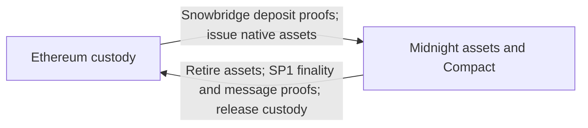

# Midnight Ethereum bridge decision brief

Decision brief | 28 October 2026

## Proposal

Bring Ethereum ERC-20 assets into Midnight for use in Compact applications, with redemption back to Ethereum. **The local proof of concept works. Production integration, security assurance and reliable operation remain.**

## Architecture

Relayers carry evidence; destination chains verify it before moving value. Security depends on source consensus, proof correctness and deployment controls. Bridge amounts and recipients are public.

## What is proven

The saved run deposited 100, used the assets in Compact, retired 40 and paid out 40 on Ethereum, including real SP1 proofs and failure/retry handling. **This validates one asset on a local single-validator network.**

## Critical delivery plan

| Phase | Required outcome |
| --- | --- |
| **1 Integrate** | Compatible ledger, node, wallet and indexer releases; existing-chain migration and real validator transitions. |
| **2 Operate** | Continuous relaying/proving, recovery and monitoring; measured production capacity, latency and cost. |
| **3 Assure** | Independent audit; failure/recovery testing; upgrade, emergency pause and custody procedures. |
| **4 Roll out** | Public testnet, capped production pilot, then expansion against agreed acceptance criteria. |

**Critical dependencies:** coordinated ledger/client releases, the production consensus-proof format, and safe SP1 receiver/custody upgrades. These determine the schedule across teams.

## Decisions for this call

1. **Scope:** one conventional ERC-20 and one network pair initially; additional assets and privacy features need separate approval.
2. **Ownership:** assign delivery and component owners; decide upgrade and emergency-pause authority.
3. **Investment:** fund production readiness and set launch criteria and pilot limits. Confirm estimates after owners size the dependencies.

**Call objective:** agree the first launch scope, accountable owners and production-readiness investment.

Supporting detail: [architecture](snowbridge-sp1-production-architecture.md) and [delivery work breakdown](snowbridge-sp1-production-work-breakdown.md).
