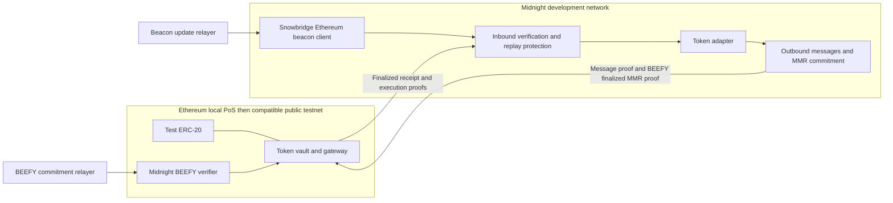

# Midnight Ethereum token transfer PoC with Snowbridge

Status: research spike, 22 October 2026.

**A direct Midnight ↔ Ethereum bridge looks feasible by adapting Snowbridge's
light clients, message proofs, and relayers. It requires a separate deployment.**
The existing Snowbridge service is a Polkadot bridge; its parachain integration
guide assumes XCM and Asset Hub. Midnight's Substrate runtime does not make it a
Polkadot parachain. [Snowbridge integration requirements][integration]

The recommended first transfer is an Ethereum test ERC-20 locked on Ethereum and
represented on Midnight, then redeemed back to Ethereum. Start with public
amounts and recipients, one allowlisted token, operator-funded relayers, a fresh
Midnight development network, and local Ethereum proof of stake at a supported
fork. A public-testnet demonstration has a separate Ethereum fork-compatibility
gate described below.

There are two distinct deliverables:

1. **Bridge transport and asset PoC:** verified transfers using a FRAME test
   asset. This exercises both light clients and supply accounting.
2. **Midnight ledger token PoC:** the representation is spendable through the
   Midnight ledger and wallet. This requires an authenticated ledger adapter;
   adding `pallet-assets` alone does not provide it.

The main unknown is the second deliverable. The main transport work is reconciling
BEEFY authority commitments, MMR leaf encoding, and relayer transaction formats.

## Existing implementations to reuse

| Route | Fit for this PoC | Decision |
| --- | --- | --- |
| Integrate with deployed Polkadot Snowbridge | Requires a separate authenticated Midnight–Polkadot bridge before Snowbridge can carry the assets onward | Avoid for the direct PoC |
| Adapt upstream Snowbridge to Midnight | Reuses Ethereum verification and BEEFY machinery; replaces parachain and XCM assumptions | Recommended foundation |
| Start from DataHaven's Snowbridge solochain fork | Already implements direct message-root verification in an MMR leaf and a solochain relayer | Evaluate and selectively reuse its adaptations |
| Relayer signatures authorize transfers | Useful as a UI mock, but does not demonstrate Snowbridge's verification model | Does not satisfy the bridge PoC |

DataHaven is a particularly relevant reference. Its fork's
[branch description][solo-readme] explicitly targets standalone Substrate chains.
Its [`BeefyVerification` library][solo-verification] proves a supplied 32-byte
application root directly against a BEEFY MMR root, and its
[`Gateway.v2_submit`][solo-gateway] uses that proof to authenticate messages.
This removes the upstream path through a parachain header and parachain-heads
Merkle tree. DataHaven's [runtime configuration][dh-config] supplies the latest
outbound message commitment as the MMR leaf's extra field.

Use this as a design reference rather than copying its complete runtime.
Midnight already pins an SDK containing Snowbridge pallets. Prefer those
dependencies and port the small standalone-chain adaptations. Compare the fork
with current upstream for security fixes, proof formats, fork support, and
licenses before choosing the implementation baseline. A fork's changes are a new
review surface; upstream audit coverage does not automatically cover them.

## What Midnight already provides

These findings are from node commit
`ad8f2802c16594fb3c0a54c5976cab98bdeaab20`. The pinned SDK is
`shieldedtech/polkadot-sdk`, tag `midnight-polkadot-stable2609`, commit
`9c7455eabd0cc2e77da867e837dfb466b11fbcf6`.

| Component | Current implementation | Consequence |
| --- | --- | --- |
| BEEFY consensus | ECDSA authority IDs, BEEFY gadget, session integration | A starting point for an Ethereum light client |
| MMR | Keccak hashing, BEEFY root digests, proof runtime APIs and RPC | Reusable proof infrastructure |
| Authority Merkle leaves | `RawBeefyId` returns compressed public-key bytes | Does not match Snowbridge's Ethereum-address leaves |
| Application data in MMR | `LeafExtra = Vec<u8>`, `BeefyDataProvider = ()` | No outbound bridge message commitment yet |
| Signed BEEFY payload | `mh` plus custom `cs`, `cb`, and sometimes `ns`, `nb` entries | Must relay the complete signed encoding |
| Equivocation handling | `EquivocationReportSystem = ()`; reporting APIs return `None` | Do not assume Polkadot's BEEFY slashing economics |
| Ledger bridge execution | Restricted Cardano/NIGHT system transactions | Not an arbitrary ERC-20 mint or burn API |

Repository entry points:
[runtime configuration](../../runtime/src/lib.rs),
[custom authority helpers](../../runtime/src/beefy.rs),
[BEEFY payload construction](../../node/src/payload.rs),
[node service](../../node/src/service.rs), and
[RPC registration](../../node/src/rpc.rs).

Two details matter during implementation:

- The live `OnNewValidatorSet` is `BeefyMmrLeaf`. The custom
  `AuthoritiesProvider` in `runtime/src/beefy.rs` is not that configured handler.
  The helper authority roots include a stake suffix, whereas the configured
  pallet's roots commit to converted authority bytes. Do not initialize an
  Ethereum verifier from an auxiliary `cb`/`nb` root merely because its name
  resembles the pallet's authority proof.
- MMR indexing must be available on the proof-serving node. The node starts its
  MMR gadget only when offchain indexing is enabled; existing local entrypoints
  use `--enable-offchain-indexing true`. BEEFY also needs valid session keys,
  active genesis configuration, and finality progress. Pallet presence alone
  does not establish that a running network produces usable proofs.

## Proposed architecture

There are four relay responsibilities, which can share processes: Ethereum
consensus updates, Ethereum deposit messages, Midnight BEEFY commitments, and
Midnight redemption messages. Relayers carry evidence; they cannot authorize
minting or release funds themselves. Their keys pay gas and submit transactions.
The bridge still needs at least one functioning relayer for progress.
[Snowbridge relayers][relayers]

### Ethereum to Midnight

1. Alice approves the test token and calls the vault's deposit method, naming a
   Midnight recipient. The vault escrows the actual received amount and emits
   a deposit event with a unique nonce and the destination domain.
2. The beacon relayer submits finalized consensus updates and sync-committee
   updates to Midnight's Ethereum client.
3. The message relayer submits the deposit log and its proof: receipt inclusion,
   execution-payload inclusion, and beacon finality or ancestry.
4. An inbound pallet invokes Snowbridge's `Verifier`, then checks the exact
   source vault, event signature, token, destination domain, recipient encoding,
   amount bounds, and unused deposit ID.
5. It credits the token representation and records the deposit as consumed in
   one atomic transition, or records a verified pending claim for a separate
   atomic claim step. A failed credit must remain retryable.

The SDK-pinned [`ethereum-client` implementation][sdk-verifier] verifies the
execution proof supplied with a message and checks the log against a receipt
proof. It does not require inventing a new Ethereum consensus verifier.
Use that implementation's proof types: older documentation describes separate
execution-header imports and should not be used as an exact API specification.
Its configured network forks and consensus constants must match the target
Ethereum network.

**Current public-testnet issue:** the Ethereum Foundation scheduled Sepolia's
Glamsterdam upgrade, including the Gloas consensus changes, for 6 October 2026.
The inspected SDK's `ForkVersions` ends at Fulu and has no Gloas entry. Therefore
Sepolia compatibility is unproven and may require new beacon types, signing
domains, execution proofs and relayer support, rather than a configuration-only
change. Test a post-upgrade receipt against the selected pallet and relayer
before committing to Sepolia. A local network pinned to a supported fork lets
the initial transport PoC proceed independently. [Ethereum Foundation
announcement][glamsterdam], [SDK beacon types][sdk-beacon-types]

### Midnight to Ethereum

1. Bob signs a redemption containing the amount and Ethereum recipient. The
   token adapter destroys the representation, or moves it into irrevocable
   redemption escrow, and queues the message atomically.
2. The outbound pallet builds a bounded batch of messages and persists its
   Keccak Merkle root at block finalization.
3. At the next block's initialization, a `BeefyDataProvider` supplies that root
   in the MMR leaf. This delay is intentional: the SDK MMR appends its leaf in
   `on_initialize`, before that block's user transactions run. Pin the mapping
   between message block, leaf index, and signed root in fixtures.
4. The BEEFY relayer advances the Ethereum light client using the complete
   signed Midnight commitment and authenticated authority transitions.
5. The message relayer supplies the redemption, message Merkle proof, encoded
   MMR leaf, and MMR inclusion proof against a root the light client accepted.
6. The Ethereum gateway checks both proofs and the message domain, consumes the
   redemption ID, and releases the escrowed ERC-20 to the committed recipient.

Retain messages and proof material so a relayer can reconstruct proofs against
the verifier's latest accepted root after downtime. An event observed over RPC
is not sufficient authorization for release.

## Resolving BEEFY and MMR compatibility

### Authority commitments

Snowbridge's [`BeefyClient.isValidatorInSet`][upstream-beefy] checks Merkle
membership of `keccak256(ethereumAddress)`. Midnight's configured conversion
uses compressed public keys. For a **fresh isolated PoC chain**, configure
`pallet_beefy_mmr::BeefyEcdsaToEthereum`, available in the pinned SDK, and prove
that the ordered current and next authority lists yield the same roots in Rust,
the relayer, and Solidity.

This changes a committed format. Applying it to an existing Midnight network
would require checking Cardano bridge and other BEEFY consumers, stored authority
roots, and transition/migration semantics. An alternative is adapting the
Ethereum verifier to Midnight's existing key commitments; that adds key-format
verification work. Make that decision separately from the isolated PoC.

### Signed payload bytes

Preserve every signed payload entry, in its actual encoded order. Extracting
`mh` and reconstructing a single-entry commitment changes the signing hash.
Upstream's current Solidity encoder accepts an array of payload items, so extra
entries are not inherently a blocker. The acceptance test is byte-for-byte SCALE
and signing-hash agreement for a real Midnight commitment, including its custom
entries. [Payload encoder][upstream-beefy]

### Application commitment

For the isolated network, replace the empty vector extra field with a fixed
32-byte message root and a provider backed by the outbound pallet. A fixed
`H256` and `Vec<u8>` containing 32 bytes have different SCALE encodings because
the vector includes a length prefix. Update the leaf version and fixture
decoders consistently; do not silently reinterpret existing leaves.

Use the direct MMR proof pattern from [DataHaven's verifier][solo-verification]
and a narrow token gateway. The upstream [parachain verifier][upstream-verification]
cannot be made correct merely by assigning Midnight a fabricated parachain ID.

### Quorum and authority rotation

For a small PoC committee, verify a full BEEFY signing quorum of distinct
validators: `N - floor((N - 1) / 3)`. Verify the next authority commitment inside
an authenticated MMR leaf, and exercise at least two committee transitions.
Provision the initial current/next sets and checkpoint from one finalized chain
state, with an explicit deployment manifest.

In the inspected solochain fork, the required-signature calculation is capped at
the quorum. Setting its minimum at least as high as the maximum PoC committee
size can force quorum verification while retaining its submission protocol.
Assert the resulting signature count for every configured committee size.
Current upstream has a different sampling cap; copying the same parameter into
it does **not** establish full-quorum verification. [Fork implementation][solo-beefy]

Production sampling needs a separate security analysis against Midnight's
committee, incentives, accountability, and recovery model. Snowbridge's
[Polkadot verification design][polkadot-verification] discusses slashing and
economic assumptions that cannot be transferred unchanged to this runtime.
Ethereum verification also inherits beacon sync-committee and trusted-checkpoint
assumptions; it is not full execution of Ethereum consensus on Midnight.
[Ethereum verification design][ethereum-verification]

## Token representation and ledger integration

### First transport milestone

Use one `pallet-assets` test asset with issuance controlled exclusively by the
verified inbound pallet. Users can transfer it between FRAME accounts and burn
it through the redemption pallet. This proves the bridge's transport and
accounting, but it is a separate balance system from Midnight's UTXO ledger.
Label its demonstration accordingly.

### Ledger and wallet milestone

The current bridge host API is purpose-specific. In
[`ledger/src/ledger_9/mod.rs`](../../ledger/src/ledger_9/mod.rs),
`apply_bridge_system_transaction` allows only Cardano-bridge NIGHT
distribution, reserve distribution, and treasury unlocking. There is no generic
foreign-asset mint/burn operation exposed through that path. Reusing it as an
Ethereum mint authority would conflate unrelated accounting domains.

Define a ledger adapter with the ledger team before promising the wallet demo:

- **Inbound:** a verified deposit creates an entitlement keyed by bridge domain
  and deposit ID. A ledger operation consumes that entitlement and creates the
  mapped public token exactly once. The asset namespace, mint authority, and
  replay state must be explicit and consistent across ledger and FRAME state.
- **Outbound:** a normal authorized ledger transaction consumes the user's
  representation and produces a redemption effect bound to amount, asset,
  nonce, and Ethereum recipient. Only a successfully applied effect may enter
  the outbox. A FRAME signature alone does not prove ownership of ledger UTXOs.
- **Failure:** ledger mutation, entitlement consumption, and outbox creation
  must commit together, including across the host storage boundary. Test block
  rollback and replay; do not assume a FRAME transaction wrapper reverses every
  host-side effect automatically.

These are proposed capabilities, not existing API names. A ledger-native bridge
asset and narrowly authorized mint operation are one implementation route; a
Compact wrapper is another. Compact already has token minting examples in
[`minter.compact`](../../util/toolkit-js/test/minter_contract/minter.compact).
However, a wrapper still needs a consensus-enforced way to consume the verified
deposit entitlement. A relayer-held minter key or witness asserting that a
deposit occurred would introduce a trusted issuer. A generic authenticated
runtime-to-Compact call is not established by this spike.

Prefer real burn semantics. If the initial ledger adapter uses redemption
escrow, it must be permanently unspendable while the Ethereum claim remains
valid, and excluded from circulating supply. A timeout that returns funds while
an old redemption proof can still execute would permit a double redemption.

Any new host capability should use versioned runtime-interface functions.
Node-facing runtime behavior should use runtime API versions, following the
repository's rules, rather than hard-coded `spec_version` thresholds.

### Supply and wire format

Use exact integer base units with no decimal conversion in the first PoC. Bound
amounts to the supported destination width and reject overflow on Ethereum
before escrow. ERC-20 amounts are `uint256`; the existing Compact mint example
accepts `Uint<64>`. Do not silently truncate to `u128` or `u64`.

Define a versioned, canonical message carrying the deployment/bridge ID, source
and destination domains, direction, nonce, asset ID, amount, and recipient.
Include the Ethereum chain ID, vault address, and Midnight genesis identity in
the deployment domain. Publish matching Rust, Go/TypeScript, and Solidity test
vectors. A Midnight ledger recipient and a FRAME `AccountId` need separate
encoding definitions; both being 32 bytes does not make them interchangeable.

For an Ethereum-origin token, track this conservation equation in base units:

`vault collateral = circulating Midnight representation + deposits awaiting mint + redemptions awaiting release`

Exclude permanently retired representations from circulation. Assert the
equation after successful steps, retries, failures, and process restarts.
Allowlist a conventional test ERC-20; rebasing and transfer-tax behavior require
additional accounting. Keep relayer fees outside the bridged principal.

## Implementation work packages

| Package | Concrete work | Exit condition | Indicative effort |
| --- | --- | --- | --- |
| A Compatibility gate | Capture a real development-network commitment, indexed MMR proof and authority lists; compare key roots, SCALE bytes, signatures and leaf layout with Solidity; select upstream/fork baseline and assess current Ethereum fork support | A real Midnight proof verifies in a contract harness; ledger team chooses the representation path; public-testnet gap is scoped | 2–4 engineer-days |
| B Verified transport | Add Ethereum client and inbound verifier; implement outbound root provider and gateway verification; adapt beacon, BEEFY and message relayers | Verified messages cross in both directions, including committee rotation | 5–10 engineer-days |
| C FRAME token round trip | ERC-20 vault, test asset adapter, replay state, redemption and CLI | Deposit, transfer between two Midnight FRAME accounts, redeem to Ethereum | 4–7 engineer-days |
| D Ledger token | Implement the agreed mint entitlement and authorized redemption effects; integrate indexer, wallet and transaction tooling | The same round trip uses actual ledger tokens with an intermediate wallet transfer | 10–20+ engineer-days, dependent on ledger API design |
| E Recovery and public testnet | Durable relayer cursors, restart/backfill, malformed proofs, pause behavior, compatible public-testnet configuration and deployment runbook | Repeatable testnet demo with recovery evidence and measured costs | 4–7 engineer-days, excluding new Ethereum fork implementation |

These are planning estimates, not measurements. A–C total roughly 11–21
engineer-days. A wallet-integrated testnet PoC is approximately 25–48+
engineer-days, or roughly 5–10+ weeks for one engineer with ledger-team support.
Compile time, upstream ledger changes, and baseline security fixes can extend
that range. New Gloas support, if required, is outside these estimates and must
be scoped in package A. Re-estimate after that gate; adding engineers does not
remove its dependencies. Production security review and deployment are separate
work.

Likely repository changes:

- `Cargo.toml`, `runtime/Cargo.toml`, `runtime/src/lib.rs`: dependencies, runtime
  configuration, authority conversion, leaf provider, weights and pallet order.
- New Ethereum inbound/outbound and token adapter pallets, with narrowly scoped
  dispatch rather than arbitrary remote runtime calls.
- `node/src/service.rs`, `node/src/payload.rs` and RPC/runtime APIs as required
  by proof and relayer compatibility.
- `ledger/`, primitives, and `pallets/midnight-system/` only after the ledger
  adapter design; separate indexer/wallet changes for the ledger milestone.
- `local-environment/`, E2E tests and CLI/toolkit commands for deployment and
  the round trip. Contract and relayer changes need pinned upstream/fork SHAs
  and regenerated ABI/metadata bindings.

Runtime storage/API changes require rebuilt metadata. The fresh network needs
updated chain/genesis configuration. Keep product change files with the eventual
implementation PRs; this research change itself changes no runtime behavior.

## Environment and acceptance tests

Run Midnight in release mode with a small multi-validator committee, finality,
BEEFY keys and MMR indexing. Use local Ethereum execution **and consensus**
clients for full E2E testing. Anvil is useful for Solidity fixtures but does not
by itself supply the finalized beacon updates needed for Ethereum-to-Midnight
verification. Snowbridge's [local test stack][local-stack] provides a reference
for execution/consensus client orchestration.

Deploy the vault, gateway and BEEFY verifier with a manifest recording chain
identities, contract addresses, token mapping, initial checkpoints, committee
sets, fork constants, proof formats and source SHAs. Fund Ethereum gas accounts
and Midnight transaction/DUST requirements independently of the test token.
Check whether the existing relayer's extrinsic signer and signed extensions fit
Midnight; standard Substrate transaction construction is not sufficient evidence
of compatibility with this runtime's fee and transaction handling.

The PoC is complete when it demonstrates:

1. Lock 100 test tokens on Ethereum; mint exactly 100 representations after
   finalized proof verification; transfer 40 to another Midnight user; redeem
   those 40; finish with 60 circulating and 60 in Ethereum escrow. Repeat with
   ledger wallets for the ledger milestone.
2. Duplicate deposit and redemption submissions do not change supply. Concurrent
   relayers and process restarts produce the same result.
3. Modified amount/recipient/token/domain, wrong emitter, incorrect receipt,
   invalid BLS signature, invalid MMR branch, insufficient or duplicate BEEFY
   signatures, and unfinalized source data are rejected.
4. Transfers work across at least two authority-set changes; stale commitments
   and unauthenticated next sets fail. Include different committee sizes and
   missing signatures.
5. Failed mint/unlock, limits reached, relayer downtime and pause/unpause preserve
   a recoverable pending transfer. No source refund exists merely because the
   destination is slow. A receipt of message submission is not proof of asset
   execution success.
6. Token effects and message consumption remain atomic across failed extrinsics,
   block rollback and node restart. Old proofs remain recoverable or the
   operational proof-retention limit is explicit.
7. The demo records per-direction finality latency, Ethereum gas for BEEFY
   updates and claims, Midnight verification weight/fees, proof sizes, and
   relayer catch-up time. Separate recurring light-client costs from per-token
   transfer costs; amortization depends on volume and batching.

Do not promise a fixed fee or transfer time from existing Polkadot numbers.
The Midnight committee, quorum verification, relayer funding and runtime weights
change those costs. Measure them on the selected implementation.

## Decisions needed after the compatibility gate

- Confirm the success criterion: FRAME transport demonstration or a
  wallet-visible ledger token. The latter is the meaningful end-to-end Midnight
  product demonstration.
- Confirm the canonical asset. This proposal uses an Ethereum test ERC-20.
  For NIGHT-origin transfers, reverse the custody model: lock existing NIGHT on
  Midnight, mint wrapped NIGHT on Ethereum, burn the wrapper, and release the
  original NIGHT. Do not mint new NIGHT on return.
- Agree the ledger authorization, asset namespace, mint/burn or escrow
  semantics, and rollback contract with the ledger team.
- Choose the standalone proof adaptation and security-fix baseline, while
  preserving a path for existing Cardano-facing BEEFY consumers.
- Verify the selected public Ethereum testnet's current consensus fork against
  both the on-chain light client and the relayer before scheduling that demo.
- Establish checkpoint, pause, upgrade and recovery authority for the PoC.
  Administrative checkpoint replacement can override the verification trust
  base; production governance needs its own design.

Shielded representations can follow the public-token PoC, but bridge entry and
exit amounts, timing and Ethereum recipients are public. Shielding a Midnight
balance does not make the cross-chain transfer unlinkable. It also adds note
delivery, proving and disclosure requirements to the ledger adapter.

## Source revisions

This is a source-level design assessment; interoperability, builds and live
proof verification remain the exit criteria of package A. Public repositories
were inspected at these revisions; moving documentation links provide context:

- Midnight node: `ad8f2802c16594fb3c0a54c5976cab98bdeaab20`.
- Midnight SDK: `9c7455eabd0cc2e77da867e837dfb466b11fbcf6`.
- Snowfork Snowbridge: `caeea22dbee4d4da06266b205a61c89484c4e89f`.
- DataHaven Snowbridge solochain branch:
  `4bebe7032d866ba6b57cda3767afaf586a92680e`.
- DataHaven's `contracts/lib/snowbridge` submodule resolved to
  `13263fefa29a3f4af50e5650dcd93fe3afac44db` at inspection. That differs from the
  inspected branch head; do not assume they are the same deployment baseline.
- DataHaven runtime configuration:
  `edcb13dbbcd3c29489eaa2480a6f60ee4cb1f3ec`.

[integration]: https://docs.snowbridge.network/developers/snowbridge-v2/parachain-integration
[relayers]: https://docs.snowbridge.network/architecture/relayers
[polkadot-verification]: https://docs.snowbridge.network/architecture/verification/polkadot
[ethereum-verification]: https://docs.snowbridge.network/architecture/verification/ethereum
[upstream-beefy]: https://github.com/Snowfork/snowbridge/blob/caeea22dbee4d4da06266b205a61c89484c4e89f/contracts/src/BeefyClient.sol
[upstream-verification]: https://github.com/Snowfork/snowbridge/blob/caeea22dbee4d4da06266b205a61c89484c4e89f/contracts/src/Verification.sol
[sdk-verifier]: https://github.com/shieldedtech/polkadot-sdk/blob/9c7455eabd0cc2e77da867e837dfb466b11fbcf6/bridges/snowbridge/pallets/ethereum-client/src/impls.rs
[sdk-beacon-types]: https://github.com/shieldedtech/polkadot-sdk/blob/9c7455eabd0cc2e77da867e837dfb466b11fbcf6/bridges/snowbridge/primitives/beacon/src/types.rs
[solo-readme]: https://github.com/datahaven-xyz/snowbridge/blob/4bebe7032d866ba6b57cda3767afaf586a92680e/README.md
[solo-verification]: https://github.com/datahaven-xyz/snowbridge/blob/4bebe7032d866ba6b57cda3767afaf586a92680e/contracts/src/BeefyVerification.sol
[solo-gateway]: https://github.com/datahaven-xyz/snowbridge/blob/4bebe7032d866ba6b57cda3767afaf586a92680e/contracts/src/Gateway.sol
[solo-beefy]: https://github.com/datahaven-xyz/snowbridge/blob/4bebe7032d866ba6b57cda3767afaf586a92680e/contracts/src/BeefyClient.sol
[dh-config]: https://github.com/datahaven-xyz/datahaven/blob/edcb13dbbcd3c29489eaa2480a6f60ee4cb1f3ec/operator/runtime/testnet/src/configs/mod.rs
[local-stack]: https://github.com/Snowfork/snowbridge/blob/caeea22dbee4d4da06266b205a61c89484c4e89f/web/packages/test/README.md
[glamsterdam]: https://blog.ethereum.org/en/2026/09/17/glamsterdam-testnet-announcement
