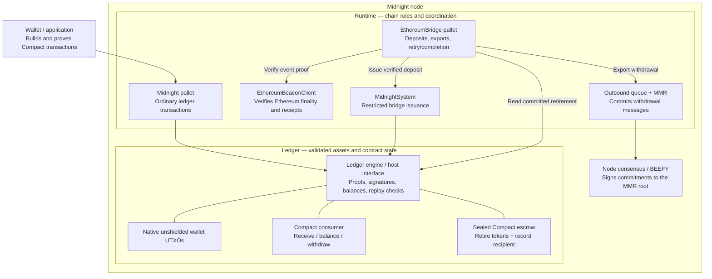
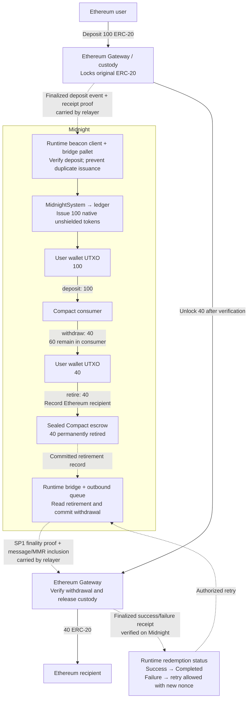
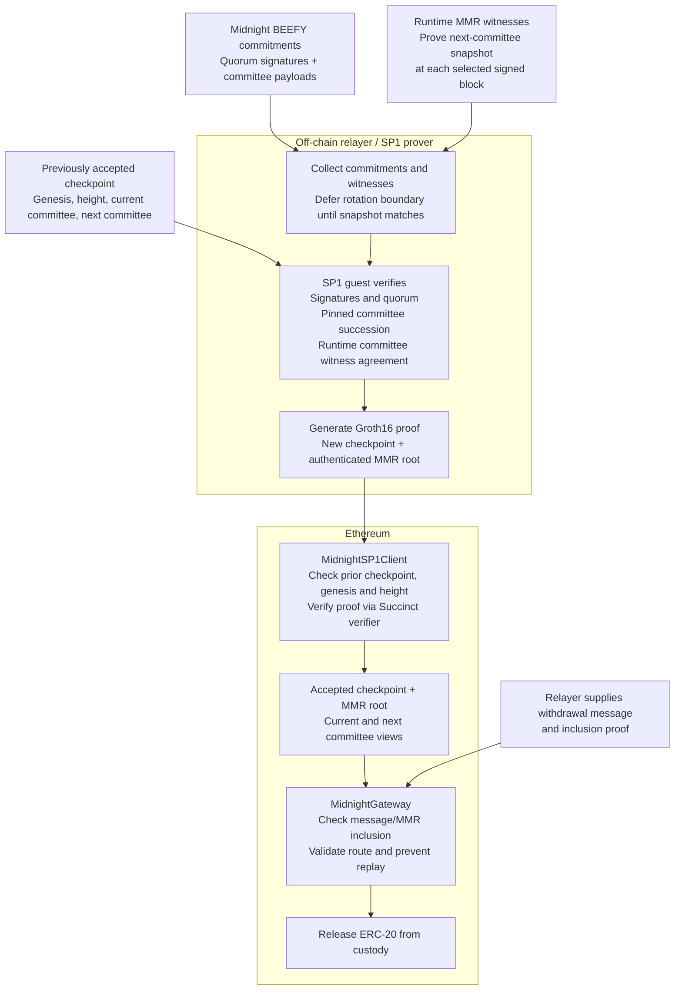

# Bridge components and flows

Midnight is the whole chain; the runtime coordinates bridge operations, the ledger
validates asset and contract state, and Compact contracts operate on those ledger
assets. The SP1 prover runs outside the chain and proves Midnight finality to
Ethereum.

These diagrams show the implemented flow, including the committee checks. View
this file in a Markdown viewer with Mermaid support to render the diagrams.

## 1. Where the components sit

Arrows here represent calls or data dependencies, rather than token transfers.

Compact contracts do not independently mint the bridged asset. Issuance passes
through the runtime’s restricted system transaction path. Their balances and
retirement records are validated and stored by the ledger.

## 2. How tokens travel in both directions

Solid arrows show asset movement or issuance. Dashed arrows show proofs and
messages.

The escrow’s 40 tokens remain in an unspendable contract balance: retirement here
means permanent locking. The tested path from the consumer to escrow goes
**through a wallet UTXO**.

Other Compact contracts can use the same native token color through ordinary
unshielded operations; the consumer demonstrates this.

## 3. What SP1 and the committee protection verify

This is the proof path behind the withdrawal arrow above. MMR means *Merkle
Mountain Range*, the authenticated structure containing the message and committee
commitments.

SP1 authenticates **Midnight finality and committee transitions**. The Gateway
separately checks that the withdrawal message belongs to the authenticated
commitment. Ethereum-to-Midnight deposits and result receipts use the runtime’s
Ethereum beacon client.

“Avail-style” describes the prover/client architecture; this implementation does
**not** send tokens or data through Avail.

The complete tested round trip ended with **60 ERC-20 in Ethereum custody, 40 paid
to the Ethereum recipient, 60 native tokens in the Compact consumer, and 40
permanently retired in escrow**. Committee checks prevent unauthorized
substitutions and rollback, but cannot detect an isolated relayer being denied
newer blocks.

## Implementation references

- [Runtime wiring](../../runtime/src/ethereum_bridge.rs)
- [Bridge state machine](../../pallets/ethereum-bridge/src/lib.rs)
- [Compact consumer](compact/consumer.compact)
- [Compact escrow](compact/escrow.compact)
- [Ethereum SP1 client](contracts/src/MidnightSP1Client.sol)
- [Ethereum Gateway](contracts/src/MidnightGateway.sol)
- [SP1 design and validation](sp1/README.md)
